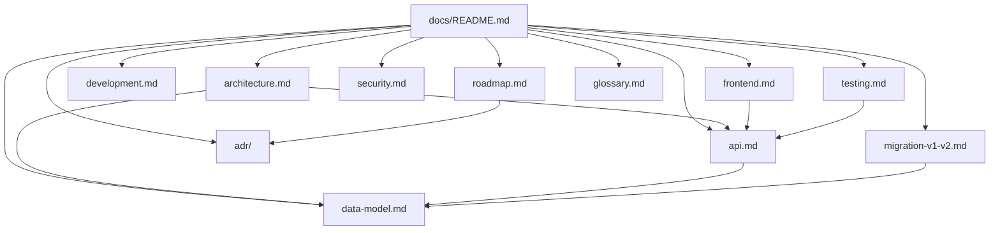

# Documentação — Job Search Assistant v2

Esta pasta concentra a documentação técnica do v2: decisões, arquitetura, modelo de dados,
API, migração do v1 e próximos passos.

## Status do projeto

| Fase | Escopo | Status |
|---|---|---|
| 0 | Modelo de dados, normalização e importação dos JSONs do v1 | ✅ Concluída |
| 1 | SQLite + Drizzle, repositórios, API REST e compatibilidade com a UI v1 | ✅ Concluída |
| 2 | Frontend React (Vite + TS + TanStack Query) | 🚧 Dashboard, detalhe e admin prontos |
| 3 | Adaptador de nuvem (Turso, Supabase ou Firestore) | ⏳ Planejada |

**Números atuais:** 16 vagas, 34 runs (17 órfãos), 97 artefatos, 4 perfis e 2 settings importados;
64 testes de backend + 17 de frontend; API e SPA na porta `3344`, Vite em `5173` e v1 intacto na
`3333`.

## Por onde começar

| Se você quer… | Leia |
|---|---|
| Entender a arquitetura em 10 minutos | [architecture.md](./architecture.md) |
| Conhecer o app React | [frontend.md](./frontend.md) |
| Ver tabelas, colunas e relações | [data-model.md](./data-model.md) |
| Consumir ou evoluir a API | [api.md](./api.md) |
| Entender como os dados do v1 foram migrados | [migration-v1-v2.md](./migration-v1-v2.md) |
| Rodar o projeto localmente | [development.md](./development.md) |
| Saber o que está testado (e o que não está) | [testing.md](./testing.md) |
| Revisar segurança e segredos | [security.md](./security.md) |
| Ver as próximas fases | [roadmap.md](./roadmap.md) |
| Entender por que cada decisão foi tomada | [adr/](./adr/README.md) |
| Consultar termos do domínio | [glossary.md](./glossary.md) |

## Mapa da documentação



## Princípios que guiam o v2

1. **Estrangulamento, não reescrita big-bang.** O v1 continua funcionando; o v2 assume
   responsabilidades em fatias (dados → API → UI).
2. **Portabilidade antes de otimização.** O modelo evita normalização excessiva para que a troca
   de SQLite por um banco de documentos seja barata.
3. **Domínio isolado da persistência.** Rotas e UI não conhecem SQL; tudo passa por repositórios.
4. **Segredos fora do banco.** Chaves de LLM permanecem em arquivo local e não são importadas.
5. **Testes como contrato.** Ao trocar o adaptador de banco, os testes de repositório dizem se o
   comportamento foi preservado.

## Diagramas

Todos os diagramas Mermaid desta pasta foram validados com `mermaid.parse()` (17/17). Para
revalidar depois de editar:

```bash
# requer mermaid e jsdom instalados em um diretório auxiliar
node /caminho/para/validate.mjs docs/
```

Regras que evitam erro de sintaxe: labels com acento, espaço, parêntese ou dois-pontos sempre entre
aspas (`["Meu rótulo"]`, `-->|"Sim"|`); nada de HTML dentro de labels; `classDef` só com `fill`,
`stroke`, `stroke-width`, `color` e `font-size`.

## Convenções

- Datas persistidas em **ISO 8601 UTC**; a conversão para `dd/mm/yyyy` existe só na borda de
  compatibilidade com o v1.
- Campos ausentes são `null`, nunca `undefined` (Firestore não aceita `undefined`).
- IDs têm prefixo (`app_`, `proc_`, `art_`) seguido de UUID.
- Toda alteração de schema gera uma migration em `drizzle/` e é registrada em um ADR quando muda
  uma decisão estrutural.
