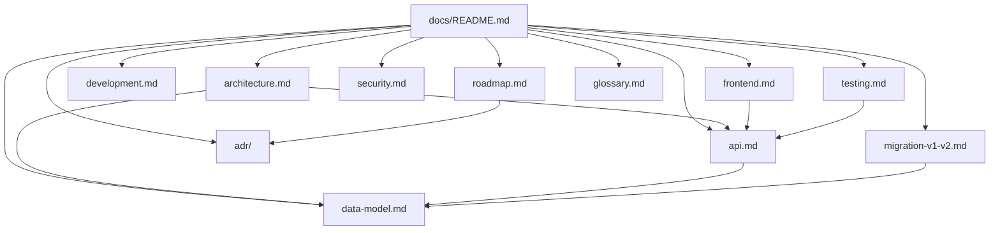

# Documentation — Job Search Assistant v2

This folder holds the technical documentation: decisions, architecture, data model, API, the
migration history and next steps.

## Project status

| Phase | Scope | Status |
|---|---|---|
| 0 | Data model, normalization and import of existing JSON files | ✅ Complete |
| 1 | SQLite + Drizzle, repositories, REST API and UI compatibility | ✅ Complete |
| 2 | React frontend (Vite + TS + TanStack Query) | 🚧 Dashboard, detail, admin and app settings done |

**Current numbers:** 16 jobs, 34 runs (17 orphans), 97 artifacts, 4 profiles and 2 settings
imported; 103 backend tests + 28 frontend tests; API and SPA on port `3344`, Vite on `5173`.

## Where to start

| If you want to… | Read |
|---|---|
| Understand the architecture in 10 minutes | [architecture.md](./architecture.md) |
| Understand the LLM and skill pipeline | [architecture.md §7](./architecture.md#7-pipeline-llm-and-skills) |
| Get to know the React app | [frontend.md](./frontend.md) |
| See tables, columns and relations | [data-model.md](./data-model.md) |
| Consume or evolve the API | [api.md](./api.md) |
| Understand how data was migrated | [migration-v1-v2.md](./migration-v1-v2.md) |
| Run the project locally | [development.md](./development.md) |
| Know what is covered (and what isn't) | [testing.md](./testing.md) |
| Review security and secrets | [security.md](./security.md) |
| See the upcoming phases | [roadmap.md](./roadmap.md) |
| Understand why each decision was made | [adr/](./adr/README.md) |
| Look up domain terms | [glossary.md](./glossary.md) |

## Documentation map



## Principles guiding v2

1. **Strangling, not a big-bang rewrite.** The app grows in slices (data → API → UI) instead of
   being rewritten at once.
2. **Portability before optimization.** The model avoids excessive normalization so swapping
   SQLite for a document database stays cheap.
3. **Domain isolated from persistence.** Routes and UI don't know SQL; everything goes through
   repositories.
4. **Secrets never leave the server.** The LLM key is stored locally and the API only ever
   returns it masked (`hasKey` + `maskedKey`).
5. **Tests as contract.** When the database adapter changes, the repository tests tell you whether
   behavior was preserved.

## Diagrams

All Mermaid diagrams in this folder were validated with `mermaid.parse()` (17/17). To revalidate
after editing:

```bash
# requires mermaid and jsdom installed in a scratch directory
node /path/to/validate.mjs docs/
```

Rules that avoid syntax errors: labels with accents, spaces, parentheses or colons always inside
quotes (`["My label"]`, `-->|"yes"|`); no HTML inside labels; `classDef` only with `fill`,
`stroke`, `stroke-width`, `color` and `font-size`.

## Conventions

- Dates persisted in **ISO 8601 UTC**; the `dd/mm/yyyy` conversion exists only at the compatibility
  boundary.
- Missing fields are `null`, never `undefined`.
- IDs have a prefix (`app_`, `proc_`, `art_`) followed by a UUID.
- Every schema change generates a migration in `drizzle/` and is recorded in an ADR when it changes
  a structural decision.
