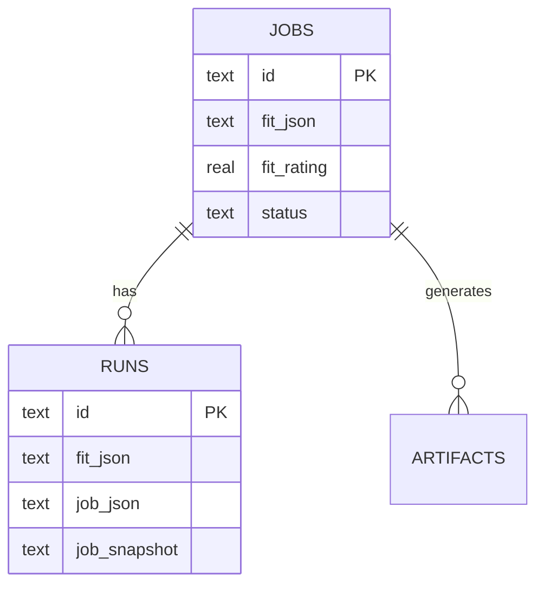

# ADR-0002 — Document-shaped model

- **Status:** Accepted
- **Date:** 2026-11-02

## Context

v1 data has naturally nested aggregates: a job carries a `fit` with dimensions, strengths and
gaps; a run carries `job`, `jobSnapshot` (with the full vacancy text), fit and flags. A fully
normalized model would require several tables (`fit_dimensions`, `strengths`, `gaps`,
`job_snapshots`) and many joins.

The stated goal is to avoid excessive normalization. An intermediate model keeps an aggregate in
one row while leaving room for relational queries when they are needed.

## Decision

Adopt a **document-shaped** model:

- `jobs.fit_json`, `runs.fit_json`, `runs.job_json` and `runs.job_snapshot` are JSON columns.
- Fields used for filtering/sorting are **duplicated** as indexable scalar columns
  (`fit_rating`, `fit_analysis`, `status`, `applied_at`).
- Simple arrays (`applied_emails`) also live in JSON.
- The `profiles` and `settings` tables store opaque JSON.

## Consequences

**Positive**

- Reading an aggregate is one row; no mandatory joins.
- Stable schema: new `Fit` fields don't require a migration.
- History preserved: the run's snapshot doesn't change when the job is edited.

**Negative**

- Controlled duplication (`fit.rating` ↔ `fit_rating`) can diverge if someone writes to the JSON
  directly. The rule is: **only the repository writes**, and it keeps both in sync.
- Queries on nested fields require `json_extract` (SQLite) or equivalents.
- No database validation for the JSON content; the guarantee comes from Zod on write.

**Mitigation**

- Repository tests verify that duplicated fields are updated together.
- `fit_rating`/`fit_analysis` are treated as projections, not as the source.

## References

- [data-model.md](../data-model.md)
- [ADR-0003 — Repository pattern](./0003-repository-pattern.md)
