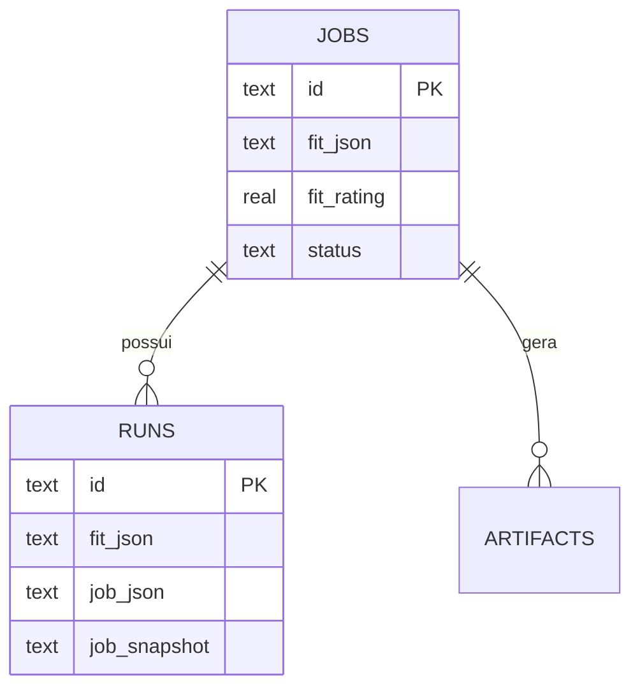

# ADR-0002 — Modelo document-shaped

- **Status:** Aceita
- **Data:** 2026-11-02

## Contexto

Os dados do v1 têm agregados naturalmente aninhados: uma vaga carrega um `fit` com dimensões,
forças e gaps; um run carrega `job`, `jobSnapshot` (com texto completo da vaga), fit e flags. Um
modelo totalmente normalizado exigiria várias tabelas (`fit_dimensions`, `strengths`, `gaps`,
`job_snapshots`) e muitos joins.

O objetivo declarado é migrar para a nuvem depois. Bancos de documentos (Firestore) não fazem
joins; bancos relacionais fazem. Um modelo intermediário reduz o custo das duas opções.

## Decisão

Adotar um modelo **document-shaped**:

- `jobs.fit_json`, `runs.fit_json`, `runs.job_json` e `runs.job_snapshot` são colunas JSON.
- Campos usados em filtro/ordenação são **duplicados** como colunas escalares indexáveis
  (`fit_rating`, `fit_analysis`, `status`, `applied_at`).
- Arrays simples (`applied_emails`) também ficam em JSON.
- Tabelas `profiles` e `settings` guardam JSON opaco.

## Consequências

**Positivas**

- Poucos joins; leitura de um agregado é uma linha.
- Migração para Firestore vira um mapeamento quase 1:1.
- Schema estável: novos campos do `Fit` não exigem migration.
- Histórico preservado: o snapshot do run não muda quando a vaga é editada.

**Negativas**

- Duplicação controlada (`fit.rating` ↔ `fit_rating`) pode divergir se alguém escrever direto no
  JSON. A regra é: **só o repositório escreve**, e ele mantém os dois em sincronia.
- Consultas por campos aninhados exigem `json_extract` (SQLite) ou equivalentes.
- Sem validação no banco para o conteúdo do JSON; a garantia vem do Zod na escrita.

**Mitigação**

- Testes de repositório verificam que os campos duplicados são atualizados juntos.
- `fit_rating`/`fit_analysis` são tratados como projeções, não como fonte.

## Referências

- [data-model.md](../data-model.md)
- [ADR-0003 — Repository pattern e nuvem](./0003-repository-pattern-e-nuvem.md)
