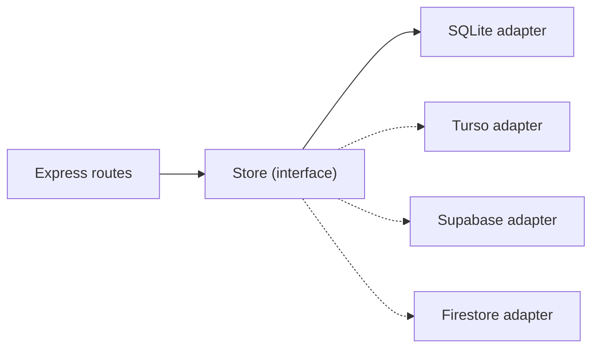

# ADR-0003 — Repository pattern and cloud path

- **Status:** Accepted
- **Date:** 2026-11-02

## Context

The decision to use SQLite now and the cloud later is only cheap if the rest of the code doesn't
know SQL. Without an abstraction layer, swapping the database would mean rewriting routes, tests
and rules.

The cloud options considered:

| Option | Model | Switch effort | Notes |
|---|---|---|---|
| **Turso/libSQL** | Distributed SQLite | Low | Same syntax; local replica |
| **Supabase/Postgres** | Relational | Medium | Integrated auth, storage and RLS |
| **Firestore** | Documents | Medium-high | No joins; requires rethinking queries |

## Decision

1. Define contracts in `src/repositories/types.ts` (`JobRepository`, `RunRepository`,
   `ArtifactRepository`, `ProfileRepository`, `SettingsRepository`, `Store`).
2. Implement the SQLite version in `src/repositories/sqlite/`.
3. Routes depend only on `Store`, injected via `createApp({ store })`.
4. Repository tests act as the **contract** for any future adapter.

## Recommended path

- **Turso** if the priority is minimal change and the app stays single-user.
- **Supabase** if auth, artifact storage and RLS are needed.
- **Firestore** only if Firebase is an explicit requirement. It forces Cloud Run for the
  Playwright/PDF pipeline, which cancels part of the serverless simplicity.

## Consequences

**Positive**

- No route or API test needs to change when swapping the database.
- The same suite can run against the new adapter before the cutover.
- `owner_id` already exists for the day authentication arrives.

**Negative**

- Extra indirection for trivial operations.
- SQL-specific features (joins, aggregations) must be expressed in the interface or stay
  restricted to the SQLite adapter — `stats()` is the current example.
- Document adapters will need composite queries or denormalization.

**Evolution rule**

When adding a method to the contract, ask: "does this make sense in Firestore?". If not, it is
probably a projection that should be computed in the adapter, not a new query.

## References

- [architecture.md](../architecture.md)
- [testing.md](../testing.md)
