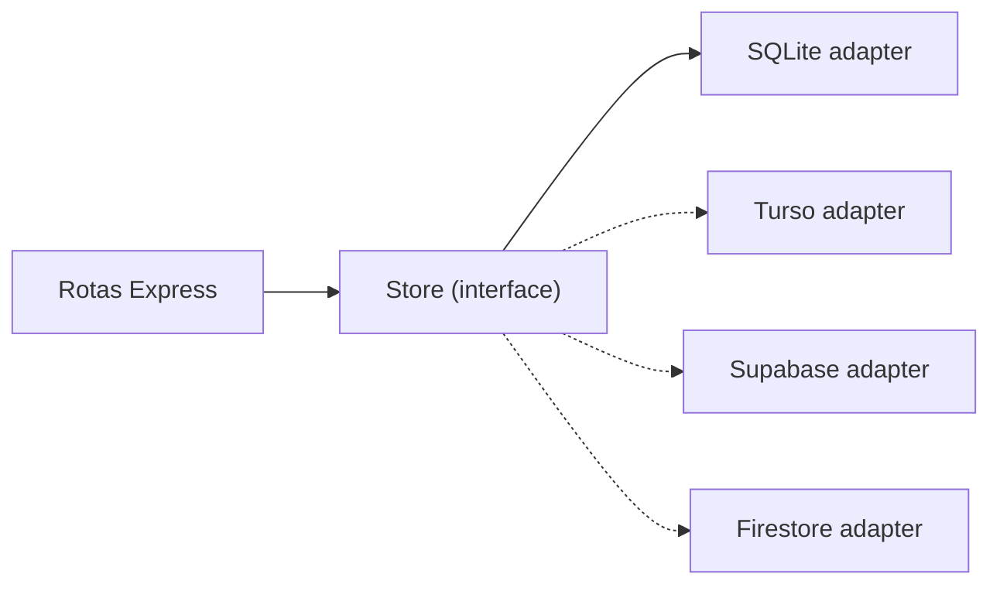

# ADR-0003 — Repository pattern e caminho de nuvem

- **Status:** Aceita
- **Data:** 2026-11-02

## Contexto

A decisão de usar SQLite agora e nuvem depois só é barata se o resto do código não conhecer SQL.
Sem uma camada de abstração, trocar o banco significaria reescrever rotas, testes e regras.

As opções de nuvem consideradas:

| Opção | Modelo | Esforço de troca | Observações |
|---|---|---|---|
| **Turso/libSQL** | SQLite distribuído | Baixo | Mesma sintaxe; réplica local |
| **Supabase/Postgres** | Relacional | Médio | Auth, storage e RLS integrados |
| **Firestore** | Documentos | Médio-alto | Sem joins; exige remodelar consultas |

## Decisão

1. Definir contratos em `src/repositories/types.ts` (`JobRepository`, `RunRepository`,
   `ArtifactRepository`, `ProfileRepository`, `SettingsRepository`, `Store`).
2. Implementar a versão SQLite em `src/repositories/sqlite/`.
3. Rotas dependem apenas de `Store`, injetado em `createApp({ store })`.
4. Testes de repositório funcionam como **contrato** para qualquer adaptador futuro.

## Caminho recomendado

- **Turso** se a prioridade for mínima mudança e o app continuar single-user.
- **Supabase** se auth, storage de artefatos e RLS forem necessários.
- **Firestore** apenas se Firebase for requisito explícito. Ele força Cloud Run para o pipeline
  Playwright/PDF, o que anula parte da simplicidade serverless.

## Consequências

**Positivas**

- Nenhuma rota ou teste de API precisa mudar ao trocar o banco.
- É possível rodar a mesma suíte contra o adaptador novo antes do cutover.
- `owner_id` já existe para o dia em que houver autenticação.

**Negativas**

- Indireção extra para operações triviais.
- Recursos específicos de SQL (joins, agregações) precisam ser expressos na interface ou ficam
  restritos ao adaptador SQLite — `stats()` é o exemplo atual.
- Adaptadores de documento vão precisar de queries compostas ou desnormalização.

**Regra de evolução**

Ao adicionar um método ao contrato, pergunte: "isso faz sentido em Firestore?". Se não fizer,
provavelmente é uma projeção que deve ser calculada no adaptador, não uma nova consulta.

## Referências

- [architecture.md](../architecture.md)
- [testing.md](../testing.md)
