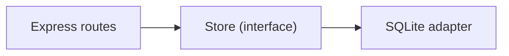

# ADR-0003 — Repository pattern

- **Status:** Accepted
- **Date:** 2026-11-02

## Context

The decision to use SQLite now is only cheap if the rest of the code doesn't know SQL. Without an
abstraction layer, swapping the database would mean rewriting routes, tests and rules.

## Decision

1. Define contracts in `src/repositories/types.ts` (`JobRepository`, `RunRepository`,
   `ArtifactRepository`, `ProfileRepository`, `SettingsRepository`, `Store`).
2. Implement the SQLite version in `src/repositories/sqlite/`.
3. Routes depend only on `Store`, injected via `createApp({ store })`.
4. Repository tests act as the **contract** for any future adapter.

## Consequences

**Positive**

- No route or API test needs to change when swapping the database.
- The same suite can run against the new adapter before the cutover.
- `owner_id` already exists for the day authentication arrives.

**Negative**

- Extra indirection for trivial operations.
- SQL-specific features (joins, aggregations) must be expressed in the interface or stay
  restricted to the SQLite adapter — `stats()` is the current example.
- Non-relational adapters will need composite queries or denormalization.

**Evolution rule**

When adding a method to the contract, ask whether it belongs in the storage contract or is a
projection that should be computed in the adapter.

## References

- [architecture.md](../architecture.md)
- [testing.md](../testing.md)
