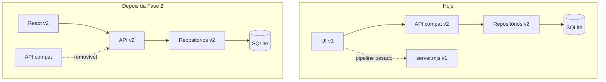

# ADR-0004 — Estratégia strangler com compatibilidade v1

- **Status:** Aceita
- **Data:** 2026-11-02

## Contexto

O v1 é um app funcional com pipeline pesado (Playwright, LLM, PDF) e uma UI vanilla de arquivo
único. Uma reescrita big-bang exigiria portar o pipeline inteiro antes de qualquer entrega, com
risco alto e nenhum feedback intermediário.

## Decisão

Aplicar o padrão **strangler**: o v2 cresce ao redor do v1, assumindo responsabilidades em fatias.

1. **Dados primeiro.** Importador one-off leva os JSONs para SQLite. O v1 continua lendo os JSONs.
2. **API em paralelo.** O v2 expõe rotas novas (`/api/jobs`, `/api/runs`) e uma camada de
   compatibilidade (`/api/applications`, `/api/processes`) que devolve exatamente o DTO antigo.
3. **UI por último.** O React substitui telas uma a uma; a camada de compatibilidade só é removida
   quando a última tela migrar.
4. **Pipeline por último.** Playwright/LLM/PDF continuam no v1 até a Fase 3.

## Consequências

**Positivas**

- O app nunca fica quebrado; cada fase entrega valor.
- A UI v1 serve de oráculo para validar a API nova.
- O pipeline pode ser portado sem pressa.
- Rollback é trivial: basta parar o v2.

**Negativas**

- Duas fontes de verdade temporárias (JSONs do v1 e SQLite do v2). Mitigado por: só o v2 escreve
  no SQLite, e a importação é one-off.
- Código de compatibilidade é dívida técnica explícita. Tem prazo: morre com a UI v1.
- Portas e diretórios compartilhados exigem disciplina (`3333` vs `3344`).

**Regra**

Nenhuma feature nova deve ser implementada na UI v1. Correções críticas podem ir para os dois, mas
o caminho é sempre o v2.

## Referências

- [migration-v1-v2.md](../migration-v1-v2.md)
- [api.md](../api.md)
