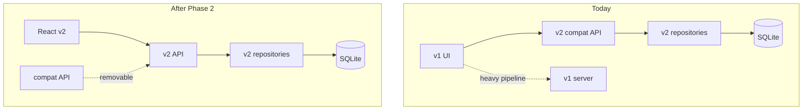

# ADR-0004 — Strangler strategy with v1 compatibility

- **Status:** Accepted
- **Date:** 2026-11-02

## Context

v1 is a working app with a heavy pipeline (Playwright, LLM, PDF) and a single-file vanilla UI. A
big-bang rewrite would require porting the whole pipeline before any delivery, with high risk and
no intermediate feedback.

## Decision

Apply the **strangler** pattern: v2 grows around v1, taking over responsibilities in slices.

1. **Data first.** A one-off importer moves the JSONs into SQLite. v1 keeps reading the JSONs.
2. **API in parallel.** v2 exposes new routes (`/api/jobs`, `/api/runs`) and a compatibility layer
   (`/api/applications`, `/api/processes`) that returns exactly the old DTO.
3. **UI last.** React replaces screens one by one; the compatibility layer is only removed when the
   last screen migrates.
4. **Pipeline last.** Playwright/LLM/PDF stay in the previous server until the pipeline port.

## Consequences

**Positive**

- The app is never broken; each phase delivers value.
- The v1 UI serves as an oracle to validate the new API.
- The pipeline can be ported without rushing.
- Rollback is trivial: just stop v2.

**Negative**

- Two temporary sources of truth (v1 JSONs and v2 SQLite). Mitigated by: only v2 writes to
  SQLite, and the import is one-off.
- Compatibility code is explicit technical debt. It has an expiry date: it dies with the v1 UI.
- Shared ports and directories require discipline (`3333` vs `3344`).

**Rule**

No new feature should be implemented in the v1 UI. Critical fixes may go to both, but the path
forward is always v2.

## References

- [migration-v1-v2.md](../migration-v1-v2.md)
- [api.md](../api.md)
