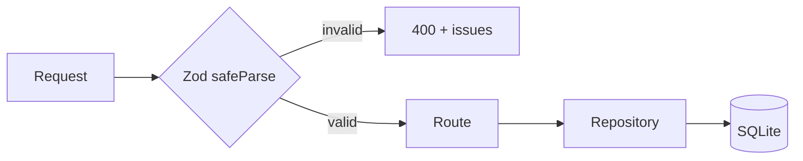

# ADR-0007 — Zod at the HTTP boundary

- **Status:** Accepted
- **Date:** 2026-11-02

## Context

Routes receive bodies from three sources with different trust levels:

1. The new React UI (yet to be written), which can be typed.
2. The v1 UI, which sends the legacy DTO with free-form fields and old names.
3. `curl`, scripts and future integrations.

TypeScript validates nothing at runtime. Without explicit validation, a `status: "encerrado"` or
a `fitRating: "alto"` would enter the database and break reads later on.

## Decision

- **Zod at the boundary**: every `POST`/`PATCH`/`PUT` goes through `parseBody(schema, req.body)`.
- Schemas live in the domain (`src/domain/job.ts`, `src/domain/run.ts`) and are the source of the
  types (`z.infer`).
- Validation errors become `400` with the list of `issues`.
- The legacy DTO has its own conversions (`legacyApplicationPatch`, `legacyProcessPatch`) because
  it replicates the old format; still, types are normalized before reaching the repository.
- The repository trusts the received type; it does not revalidate.

## Consequences

**Positive**

- A single source of truth for type + validation.
- Consistent, specific error messages.
- Refactoring a field updates type and validation together.
- Protects the database from malformed data coming from any client.

**Negative**

- Patch schemas are more complex (`partial`, `nullable`, `optional`).
- Zod adds bundle weight — irrelevant in the backend.
- The legacy DTO partially escapes strict validation, by design.

**Rule**

If a new field needs to be accepted by the API, it enters the schema **before** it enters the
repository.

## References

- `src/domain/job.ts`
- `src/domain/run.ts`
- `src/api/http.ts`
