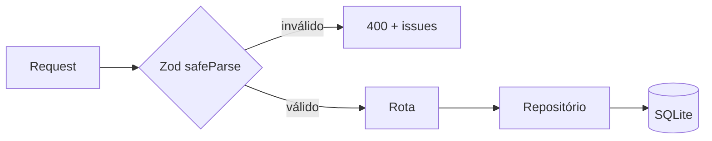

# ADR-0007 — Zod na borda HTTP

- **Status:** Aceita
- **Data:** 2026-11-02

## Contexto

As rotas recebem corpos de três origens com níveis de confiança diferentes:

1. A UI React nova (a ser escrita), que pode ser tipada.
2. A UI v1, que envia o DTO legado com campos livres e nomes antigos.
3. `curl`, scripts e futuras integrações.

TypeScript não valida nada em runtime. Sem validação explícita, um `status: "encerrado"` ou um
`fitRating: "alto"` entraria no banco e quebraria a leitura depois.

## Decisão

- **Zod na borda**: todo `POST`/`PATCH`/`PUT` passa por `parseBody(schema, req.body)`.
- Schemas ficam no domínio (`src/domain/job.ts`, `src/domain/run.ts`) e são a fonte dos tipos
  (`z.infer`).
- Erros de validação viram `400` com a lista de `issues`.
- O DTO legado tem conversão própria (`legacyApplicationPatch`, `legacyProcessPatch`) porque
  replica o formato antigo; ainda assim, os tipos são normalizados antes de chegar ao repositório.
- O repositório confia no tipo recebido; não revalida.

## Consequências

**Positivas**

- Uma única fonte de verdade para tipo + validação.
- Mensagens de erro consistentes e específicas.
- Refatorar um campo atualiza tipo e validação juntos.
- Protege o banco de dados malformados vindos de qualquer cliente.

**Negativas**

- Schemas de patch são mais complexos (`partial`, `nullable`, `optional`).
- Zod adiciona peso ao bundle — irrelevante no backend.
- O DTO legado escapa parcialmente da validação estrita, por design.

**Regra**

Se um campo novo precisa ser aceito pela API, ele entra no schema **antes** de entrar no
repositório.

## Referências

- `src/domain/job.ts`
- `src/domain/run.ts`
- `src/api/http.ts`
