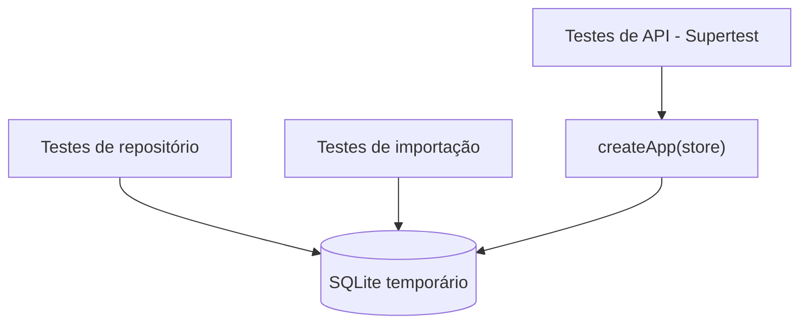

# ADR-0008 — Vitest e Supertest

- **Status:** Aceita
- **Data:** 2026-11-02

## Contexto

O v1 não tinha testes automatizados. A migração envolve normalização de dados, SQL e uma camada de
compatibilidade — três áreas onde regressões silenciosas são prováveis. Era preciso escolher um
runner e uma estratégia de teste que rodassem rápido e sem infraestrutura.

## Decisão

- **Vitest 4** como runner (integrado ao ecossistema Vite, ESM nativo, watch rápido).
- **Supertest 7** para exercitar as rotas Express sem abrir porta.
- Cada teste cria um **SQLite temporário** via `createTestStore()`, com `cleanup()` no `afterEach`.
- Três níveis:
  1. **Repositório** — SQL, filtros, cascatas, projeções.
  2. **Importação** — normalização de datas, status, fit e snapshots.
  3. **API** — status codes, DTOs, validação, visualizadores.

## Consequências

**Positivas**

- Suíte completa em ~2–3 segundos.
- Sem servidor rodando, sem porta, sem mock de banco.
- Testa o SQL real, não um dublê — pega erro de migration e de tipo.
- `createApp` recebe `store` por injeção, o que torna o teste trivial.

**Negativas**

- Testes de API e repositório compartilham SQLite; um bug de schema aparece em vários lugares.
- Sem teste end-to-end no navegador (a UI v1 não é testada).
- O pipeline pesado fica fora da suíte.

**Convenção**

- Nome do teste descreve comportamento, não função (`'esconde runs concluídos'`, não `'test list'`).
- Dados de teste são criados explicitamente em cada arquivo; sem fixture global compartilhada.
- Ao trocar o adaptador de banco, a suíte de repositório deve rodar sem alteração.

## Referências

- [testing.md](../testing.md)
- `test/helpers.ts`
