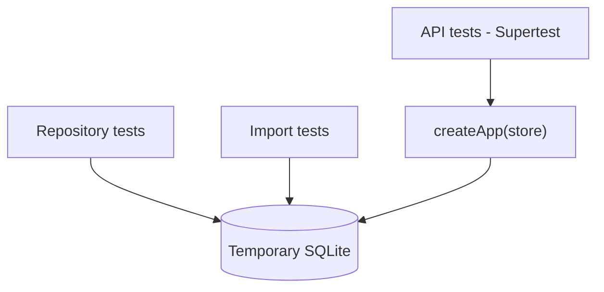

# ADR-0008 — Vitest and Supertest

- **Status:** Accepted
- **Date:** 2026-11-02

## Context

v1 had no automated tests. The migration involves data normalization, SQL and a compatibility
layer — three areas where silent regressions are likely. A runner and a test strategy had to be
chosen so everything runs fast and without infrastructure.

## Decision

- **Vitest 4** as the runner (integrated with the Vite ecosystem, native ESM, fast watch).
- **Supertest 7** to exercise the Express routes without opening a port.
- Each test creates its own **temporary SQLite** via `createTestStore()`, with `cleanup()` in
  `afterEach`.
- Three levels:
  1. **Repository** — SQL, filters, cascades, projections.
  2. **Import** — normalization of dates, status, fit and snapshots.
  3. **API** — status codes, DTOs, validation, viewers.

## Consequences

**Positive**

- Full suite in ~2–3 seconds.
- No running server, no port, no database mock.
- Tests real SQL, not a stand-in — catches migration and type errors.
- `createApp` receives `store` by injection, which makes testing trivial.

**Negative**

- API and repository tests share SQLite; one schema bug shows up in several places.
- No browser end-to-end test (the v1 UI is not tested).
- The heavy pipeline stays out of the suite.

**Convention**

- Test names describe behavior, not function (`'esconde runs concluídos'`, not `'test list'`).
- Test data is created explicitly in each file; no shared global fixture.
- When swapping the database adapter, the repository suite must run unchanged.

## References

- [testing.md](../testing.md)
- `test/helpers.ts`
