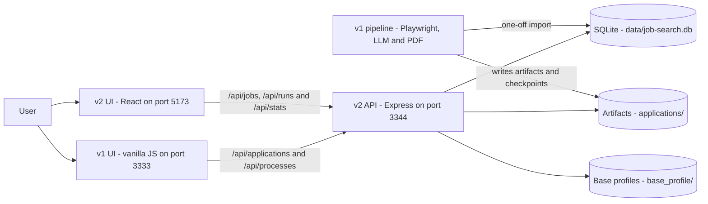
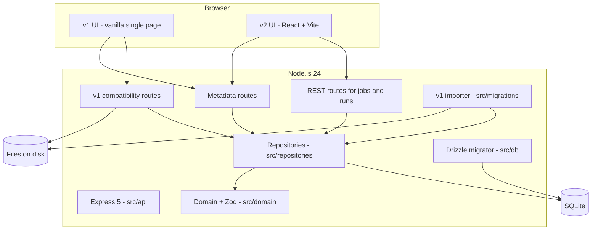
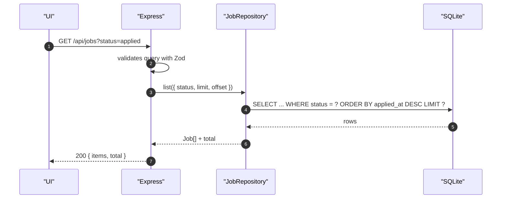
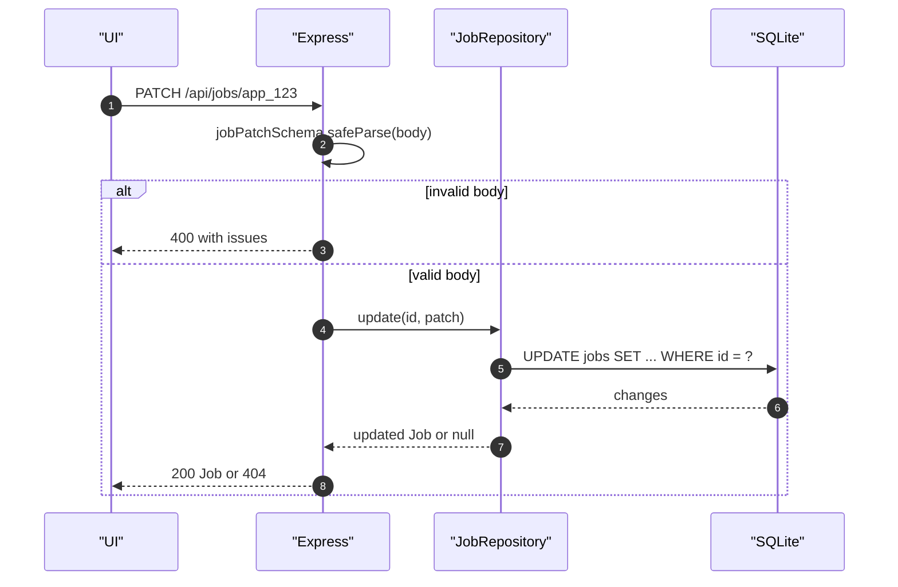
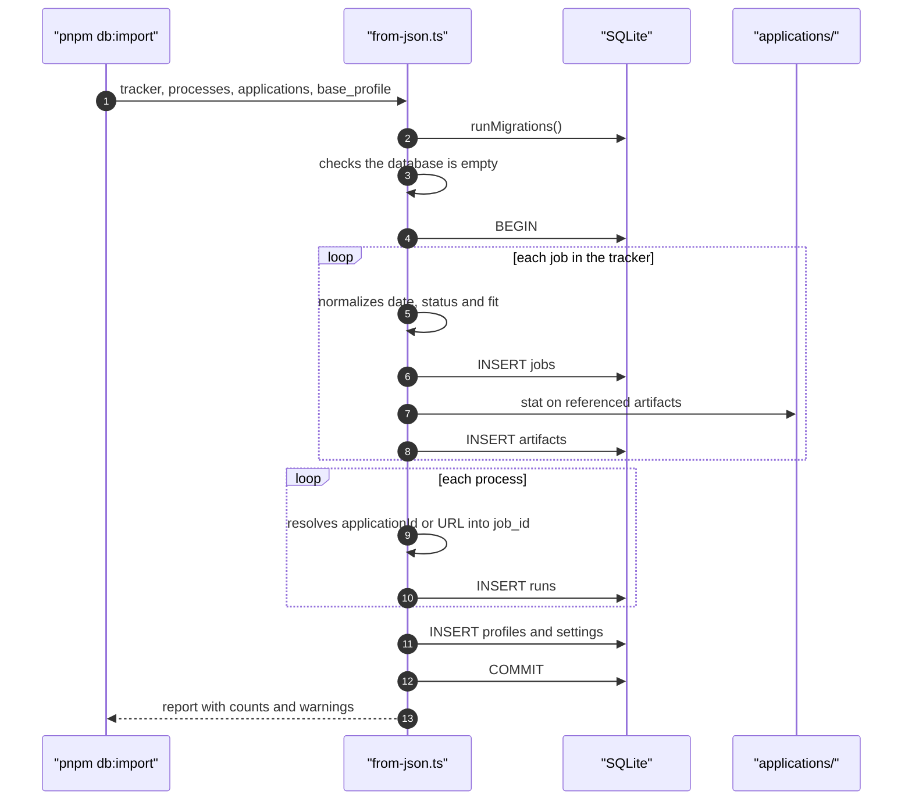
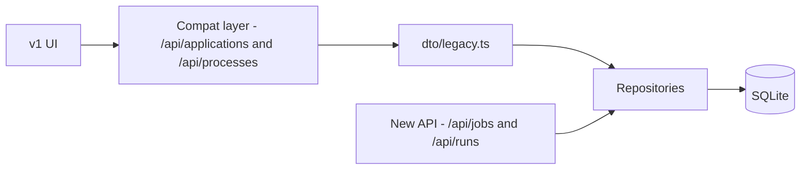
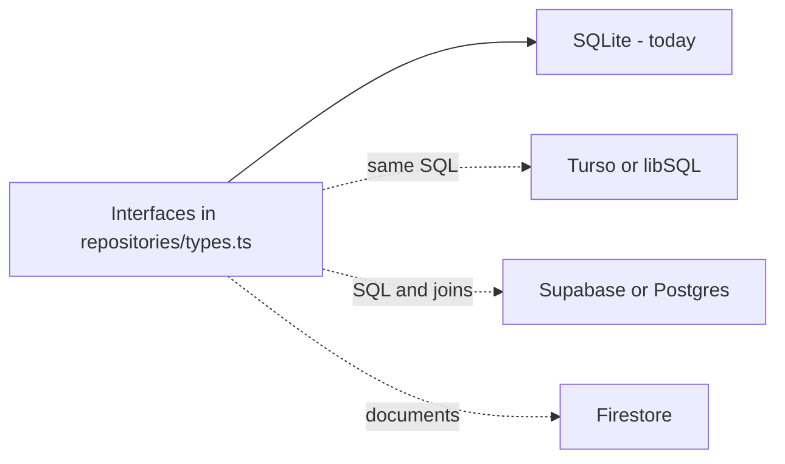

# Architecture

## 1. Overview

v2 is a **local-first** application with three blocks:

1. **UI** — today the v1 vanilla page; from Phase 2 on, a React app.
2. **API** — Express 5, owning validation, access rules and format translation.
3. **Persistence** — SQLite for structured data and the filesystem for generated artifacts
   (PDF, HTML, TXT).

v1's heavy pipeline (Playwright, LLM, PDF generation) **has not been ported yet**; it stays on the
old server. v2 is today the source of truth for job, run and artifact data.

## 2. Context



## 3. Containers



### Responsibilities

| Component | Responsibility | Does not do |
|---|---|---|
| `src/api` | HTTP, input validation, status codes, DTOs | SQL, deep business logic |
| `src/domain` | Types, Zod schemas, dates, IDs | Database access |
| `src/repositories` | Contracts and SQLite implementation | HTTP, UI formatting |
| `src/db` | Drizzle schema, connection, migrations | Business logic |
| `src/migrations` | One-off import from v1 | Runtime usage |
| `web/` (Phase 2) | React UI, data cache, navigation | Direct SQLite access |

## 4. Folder structure

```text
job-search-v2/
├── web/                        # React frontend (Vite + TanStack Query)
│   ├── src/
│   │   ├── api/                # client, types and hooks
│   │   ├── components/         # layout, fit, runs, artifacts
│   │   ├── pages/              # dashboard and detail
│   │   └── lib/                # formatting and labels
│   └── dist/                   # build served by Express
├── src/
│   ├── api/
│   │   ├── app.ts              # mounts Express and middlewares
│   │   ├── server.ts           # bootstrap, port, shutdown
│   │   ├── http.ts             # HttpError, parseBody, error handler
│   │   ├── dto/legacy.ts       # translation to the v1 format
│   │   └── routes/
│   │       ├── jobs.ts         # /api/jobs
│   │       ├── runs.ts         # /api/runs
│   │       ├── meta.ts         # profiles, settings, pdf-theme, candidate-data
│   │       ├── compat.ts       # /api/applications and /api/processes
│   │       └── viewers.ts      # /cv/:id and /extras/:id/:view
│   ├── domain/                 # Job, Run, Fit, Artifact, dates, IDs
│   ├── db/                     # schema, SQLite client, migrator
│   ├── repositories/           # interfaces + SQLite implementation
│   └── migrations/from-json.ts # v1 importer
├── drizzle/                    # generated SQL migrations
├── test/                       # Vitest + Supertest
├── data/                       # local SQLite (gitignored)
└── docs/                       # this documentation
```

## 5. Read flow



## 6. Write flow



## 7. Import from v1



## 8. Compatibility strategy



The old UI doesn't talk to the database: it talks to routes that translate the new domain into the
old DTO. Once React takes over, the compatibility layer can be removed without touching the
repositories.

## 9. Evolution to the cloud



The current model was designed to make the swap cheap: JSON aggregates, no mandatory joins, stable
IDs and `owner_id` from the start. The details are in
[ADR-0002](./adr/0002-document-shaped-model.md) and
[ADR-0003](./adr/0003-repository-pattern-and-cloud.md).

## 10. Quality attributes

| Attribute | How it is addressed | Current limit |
|---|---|---|
| Simplicity | One Node process, one SQLite file, no infrastructure | Doesn't scale to multiple concurrent users |
| Portability | Repositories + JSON columns + ISO + `owner_id` | The legacy DTO still couples the v1 UI |
| Testability | 64 backend tests + 23 frontend tests; temporary database and Supertest | Heavy pipeline not tested in v2 |
| Security | Zod validation, path traversal blocked, secrets out of the database | No authentication; assumes local use |
| Performance | Indexes on status, date, company and job_id; WAL | No cache; N+1 when listing artifacts per job |
| Observability | Error logs in the global handler; health check | No metrics or tracing |

## 11. Known limits

- v2 **does not run** Playwright, LLM calls or PDF generation.
- There is no authentication; `owner_id` exists but is always `local`.
- The `/api/applications` listing runs one artifact query per job (N+1). For 16 jobs it's
  irrelevant; it will be solved in React with an aggregate endpoint or `IN (...)`.
- The v1 UI still calls processing routes that only exist on the old server.
- React covers dashboard and detail; admin (profiles, theme, form data) has not been migrated yet.
- Dashboard filters are not in the URL.

## 12. Related decisions

- [ADR-0001 — SQLite in the backend](./adr/0001-sqlite-in-backend.md)
- [ADR-0002 — Document-shaped model](./adr/0002-document-shaped-model.md)
- [ADR-0003 — Repositories and cloud](./adr/0003-repository-pattern-and-cloud.md)
- [ADR-0004 — Strangler strategy](./adr/0004-strangler-strategy-v1-compatibility.md)
- [ADR-0005 — Identity, dates and nulls](./adr/0005-identity-datas-and-nulls.md)
- [ADR-0006 — Artifacts on the filesystem](./adr/0006-artifacts-on-the-filesystem.md)
- [ADR-0007 — Zod at the boundary](./adr/0007-zod-at-the-http-boundary.md)
- [ADR-0008 — Vitest and Supertest](./adr/0008-vitest-supertest.md)
