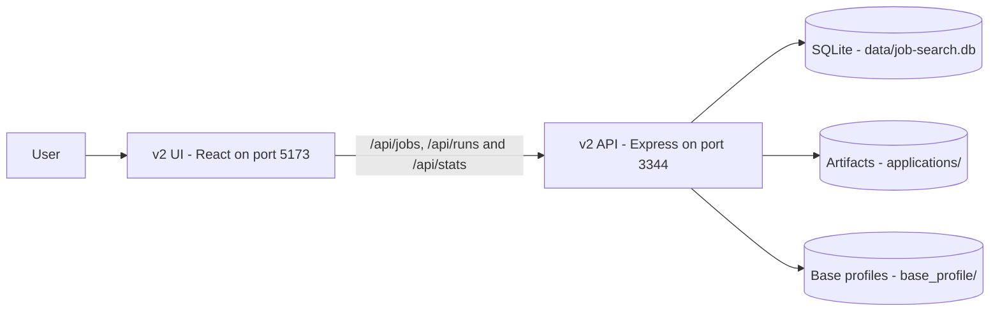
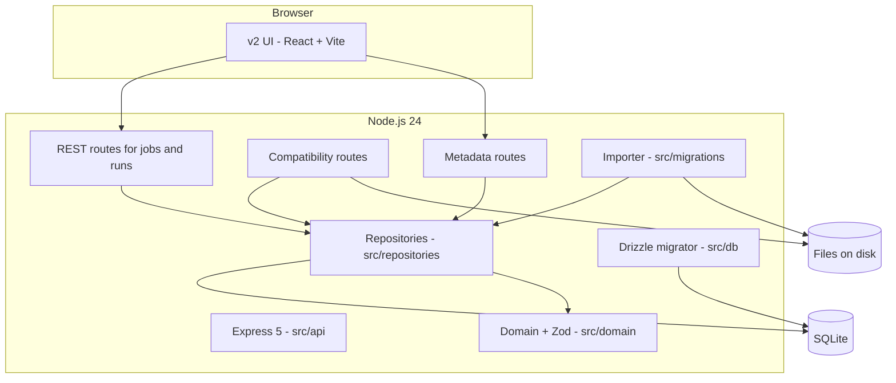
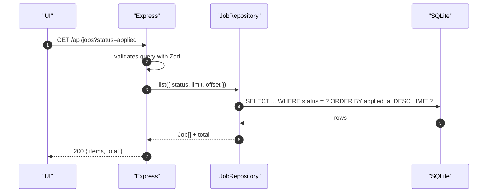
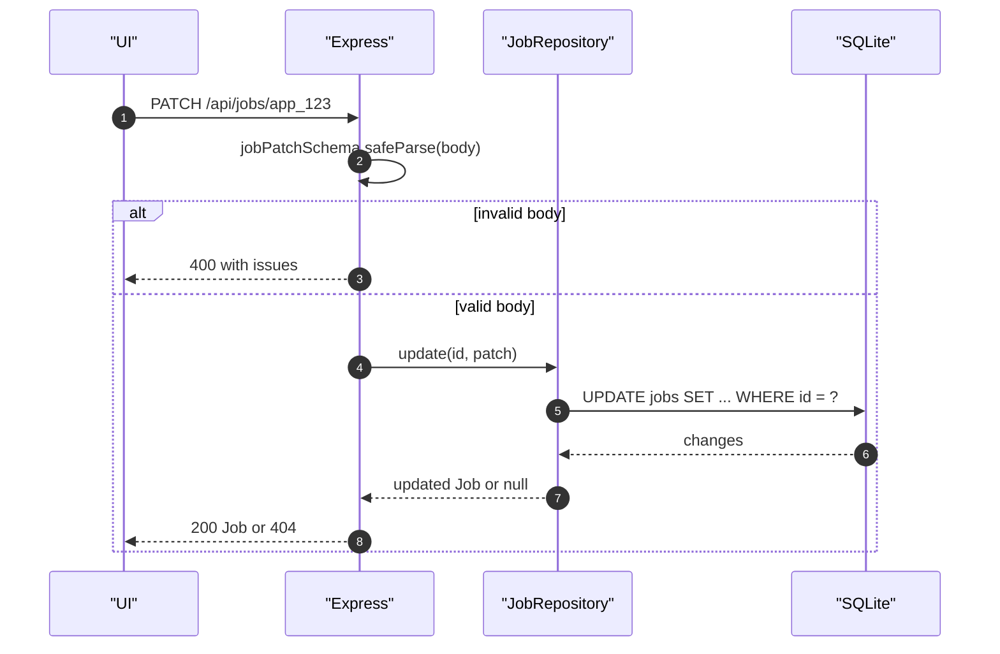
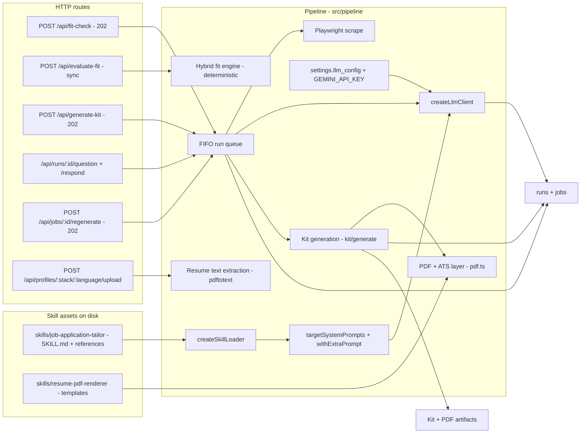
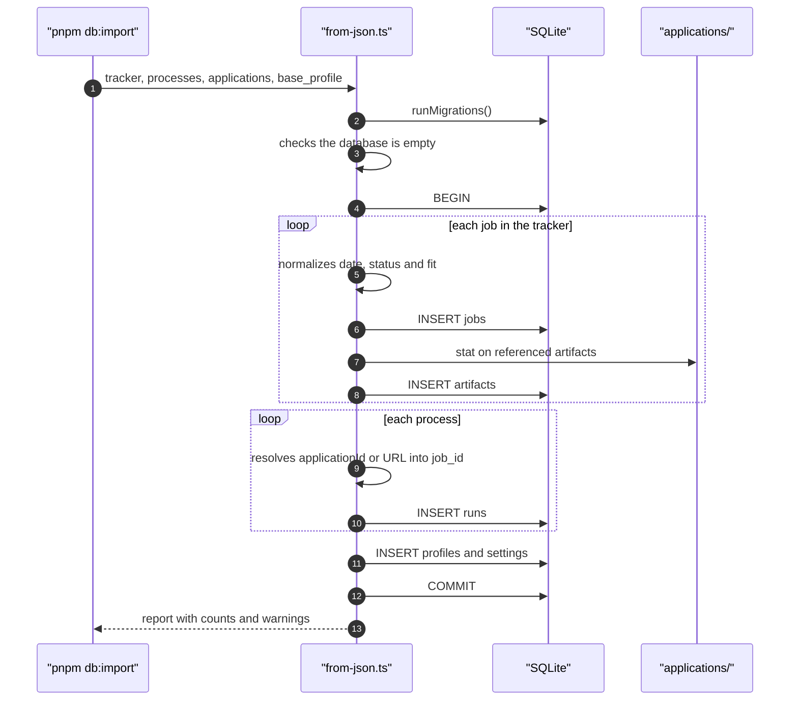
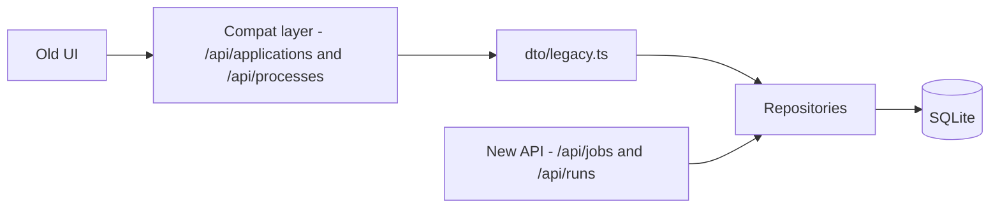

# Architecture

## 1. Overview

v2 is a **local-first** application with three blocks:

1. **UI** — a React SPA in `web/`, served by Express in production.
2. **API** — Express 5, owning validation, access rules and format translation.
3. **Persistence** — SQLite for structured data and the filesystem for generated artifacts
   (PDF, HTML, TXT).

The pipeline is being ported slice by slice. Phases 1–5 are done: **Playwright scraping**, the
**deterministic hybrid fit**, the **LLM fit check**, the **async run queue**, **kit generation with
PDF output**, the **interactive queue** and the **base resume upload** live in `src/pipeline/` and
are exposed by v2. The React UI drives checkpoints and pipeline entrypoints; the previous server
remains available on port `3333` only as a fallback.

## 2. Context



This is the runtime of the app. Compatibility, the one-off import and the external pipeline are
covered in §9, §8 and §7.

## 3. Containers



### Responsibilities

| Component | Responsibility | Does not do |
|---|---|---|
| `src/api` | HTTP, input validation, status codes, DTOs | SQL, deep business logic |
| `src/domain` | Types, Zod schemas, dates, IDs | Database access |
| `src/repositories` | Contracts and SQLite implementation | HTTP, UI formatting |
| `src/db` | Drizzle schema, connection, migrations | Business logic |
| `src/migrations` | One-off import of existing data | Runtime usage |
| `web/` | React UI, data cache, navigation | Direct SQLite access |

## 4. Folder structure

```text
job-search-v2/
├── web/                        # React frontend (Vite + TanStack Query)
│   ├── src/
│   │   ├── api/                # client, types and hooks
│   │   ├── components/         # layout, fit, runs, artifacts
│   │   ├── pages/              # dashboard, detail, admin and app settings
│   │   └── lib/                # formatting and labels
│   └── dist/                   # build served by Express
├── src/
│   ├── api/
│   │   ├── app.ts              # mounts Express and middlewares
│   │   ├── server.ts           # bootstrap, port, shutdown
│   │   ├── http.ts             # HttpError, parseBody, error handler
│   │   ├── dto/legacy.ts       # translation to the compatibility format
│   │   └── routes/
│   │       ├── jobs.ts         # /api/jobs
│   │       ├── runs.ts         # /api/runs
│   │       ├── meta.ts         # profiles, settings, llm-config, pdf-theme, candidate-data
│   │       ├── compat.ts       # /api/applications and /api/processes
│   │       └── viewers.ts      # /cv/:id and /extras/:id/:view
│   ├── domain/                 # Job, Run, Fit, Artifact, LlmConfig, dates, IDs
│   ├── db/                     # schema, SQLite client, migrator
│   ├── repositories/           # interfaces + SQLite implementation
│   ├── pipeline/               # LLM client, LLM config and skill prompt loader
│   └── migrations/from-json.ts # importer
├── skills/                     # skill assets (SKILL.md + references/ + templates/)
├── drizzle/                    # generated SQL migrations
├── test/                       # Vitest + Supertest
├── data/                       # local SQLite (gitignored)
└── docs/                       # this documentation
```

## 5. Read flow



## 6. Write flow



## 7. Pipeline: LLM and skills

The pipeline modules live in `src/pipeline/` and consume the skill assets in `skills/`.
All phases are wired end to end: fit check, kit generation, PDF/ATS output and the interactive
queue.



| Module | Responsibility |
|---|---|
| `src/pipeline/llm/client.ts` | `createLlmClient()` — non-streaming calls with retry/backoff (2 s / 6 s / 12 s) on 429, 5xx and transient errors; dispatch for Gemini, OpenAI/NVIDIA/OpenAI-compatible and Anthropic |
| `src/pipeline/llm/config.ts` | `loadLlmConfig()` / `saveLlmConfig()` — persists in `settings['llm_config']`, merges partial patches and falls back to `GEMINI_API_KEY` |
| `src/pipeline/skills/loader.ts` | `createSkillLoader()` — reads `SKILL.md` and `references/*.md` under `skills/job-application-tailor/`, caches them and builds the fit, tailor and email system prompts |
| `src/pipeline/prompts.ts` | `resolveTargetProfile()`, `withExtraPrompt()`, `targetSystemPrompts()` — only enabled targets participate and `extraPrompt` is appended as style guidance |
| `src/pipeline/content.ts` | Thin-content detection, PT/EN heuristic, explicit language requirement and logistics note — all deterministic |
| `src/pipeline/scrape/job.ts` | Greenhouse API-first scrape, Playwright fallback, injectable browser |
| `src/pipeline/fit/**` | Port of the v1 hybrid engine: semantic similarity, temporal experience, evidence and final calibration |
| `src/pipeline/kit/fit.ts` | `checkJobFit()` — LLM fit check with the skill framework and the enabled target's `extraPrompt` |
| `src/pipeline/kit/generate.ts` | Pure kit generation steps: job resolution, target resume, deterministic pre-pass, prompt, tolerant JSON parse and validator retry (max 2 fix prompts) |
| `src/pipeline/kit/slug.ts` | `getCandidateFileSlug()` from `settings.candidate_form`, name sanitizing and role truncation |
| `src/pipeline/kit/suggestions.ts` | Deterministic question/answer suggestions (no LLM) |
| `src/pipeline/kit/validate.ts` | Resume/content validators: coverage, hallucination, cliché, ammo, accent and layout |
| `src/pipeline/kit/artifacts.ts` | Writes the kit folder (`applications/<company>_<role>[_N]`) and records rows in `artifacts` |
| `src/pipeline/pdf.ts` | Chromium `page.pdf` (A4, 15 mm, `printBackground`) plus `pdftotext -layout` → `_ats_layer.txt` and `atsCompatible` |
| `src/pipeline/resume-text.ts` | `createResumeTextExtractor()` — `pdftotext` for PDFs, UTF-8 for text files; injectable in tests |
| `src/pipeline/candidate-data.ts` | `extractCandidateFromTexts()` / `candidateFromStore()` — contact data derived from the base resume |
| `src/pipeline/apply/assistant.ts` | Browser contract and Chromium launcher shared by the application-question extractor |
| `src/pipeline/apply/questions.ts` | `scrapeApplicationQuestions()` — one DOM walk plus pure platform detection, standard-field mapping and categorisation |
| `src/pipeline/apply/confirm.ts` | `confirmApplication()` — manual apply confirmation behind the `approved: true` lock; sanitizes channel, note and e-mails |
| `src/pipeline/chat.ts` | `respondToChat()` — synchronous, grounded post-response chat; persists the thread per job and redacts provider errors |
| `src/pipeline/queue.ts` | FIFO queue, one pipeline execution at a time |
| `src/pipeline/service.ts` | Wires store, loader, LLM, scraper and queue; injectable in tests |
| `src/api/routes/pipeline.ts` | `POST /api/fit-check`, `/api/evaluate-fit`, `/api/generate-kit`, `/api/runs/:id/question`, `/api/runs/:id/respond`, `/api/jobs/:id/regenerate`, `/api/jobs/:id/questions` and `/api/jobs/:id/chat` |
| `src/domain/llm.ts` | Provider enum, defaults, `llmConfigPatchSchema` and the public (masked) config shape |
| `src/api/routes/meta.ts` | `GET/PUT/POST /api/llm-config`, the profile/target CRUD and the base resume upload; the key is never returned |

Flow today: `POST /api/fit-check` validates the body, creates a `queued` run and answers
`202 {runId}` → the FIFO worker scrapes (or reuses a snapshot), builds the enabled target's system
prompt → calls `createLlmClient().call(prompt, system)` → persists the checkpoint on `runs`
(`fit-checked`, `scrape-thin` or `failed`). `POST /api/generate-kit` reuses that checkpoint, asks
for a missing fact when the kit cannot be grounded (`needs_input`, at most 2 rounds), validates the
returned HTML (max 2 fix prompts), renders the PDF and records the artifacts. `POST
/api/evaluate-fit` bypasses both the queue and the LLM and runs the deterministic engine. The full
port map is in the phase history under `.plans/`; the current surface is in
[api.md](./api.md) and the phase goals in [roadmap.md](./roadmap.md).

## 8. Import of existing data



## 9. Compatibility strategy



The old UI doesn't talk to the database: it talks to routes that translate the new domain into the
old DTO. Once React takes over, the compatibility layer can be removed without touching the
repositories.

## 10. Quality attributes

| Attribute | How it is addressed | Current limit |
|---|---|---|
| Simplicity | One Node process, one SQLite file, no infrastructure | Doesn't scale to multiple concurrent users |
| Portability | Repositories + JSON columns + ISO + `owner_id` | The compatibility DTO still couples the old UI |
| Testability | 325 backend tests + 53 frontend tests; temporary database, Supertest and injected browser/LLM/`pdftotext` stubs | No real Chromium, network or `pdftotext` in the suite |
| Security | Zod validation, path traversal blocked, LLM key masked by the API | No authentication; assumes local use |
| Performance | Indexes on status, date, company and job_id; WAL | No cache; N+1 when listing artifacts per job |
| Observability | Error logs in the global handler; health check | No metrics or tracing |

## 11. Known limits

- The whole pipeline is ported: scraping, deterministic fit, LLM fit-check, kit generation, PDF
  rendering, the interactive queue, regeneration and base resume upload.
- The React job detail also exposes the question extraction, the manual apply
  confirmation and the post-response chat (synchronous, grounded on the posting + fit).
- The chat thread is stored per job and only the last 12 turns reach the prompt; the column itself
  is not pruned yet.
- The queue is in-process and lost on restart; only `runs` already persisted survive.
- There is no authentication; `owner_id` exists but is always `local`.
- The `/api/applications` listing runs one artifact query per job (N+1). For 16 jobs it's
  irrelevant; it will be solved with an aggregate endpoint or `IN (...)`.
- The old UI still calls its own processing routes; retiring it depends on the roadmap checklist.
- React covers dashboard, detail, admin, app settings, the interactive checkpoint, the pipeline
  entrypoints, question extraction, apply confirmation and the post-response chat.

## 12. Related decisions

- [ADR-0001 — SQLite in the backend](./adr/0001-sqlite-in-backend.md)
- [ADR-0002 — Document-shaped model](./adr/0002-document-shaped-model.md)
- [ADR-0003 — Repository pattern](./adr/0003-repository-pattern.md)
- [ADR-0004 — Strangler strategy](./adr/0004-strangler-strategy-v1-compatibility.md)
- [ADR-0005 — Identity, dates and nulls](./adr/0005-identity-datas-and-nulls.md)
- [ADR-0006 — Artifacts on the filesystem](./adr/0006-artifacts-on-the-filesystem.md)
- [ADR-0007 — Zod at the boundary](./adr/0007-zod-at-the-http-boundary.md)
- [ADR-0008 — Vitest and Supertest](./adr/0008-vitest-supertest.md)
- [ADR-0009 — Configurable targets](./adr/0009-configurable-targets.md)
- [ADR-0010 — Asynchronous pipeline](./adr/0010-async-pipeline.md)
- [ADR-0011 — Synchronous post-response chat](./adr/0011-post-response-chat.md)
