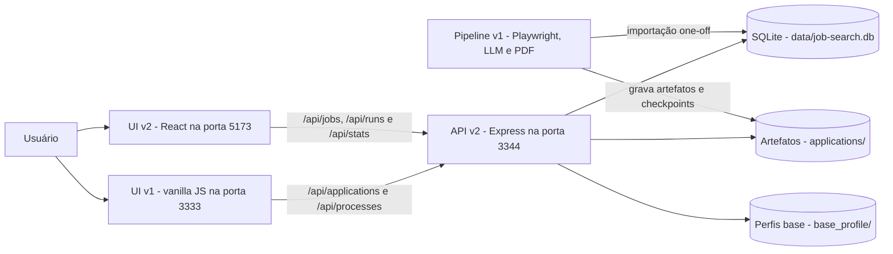
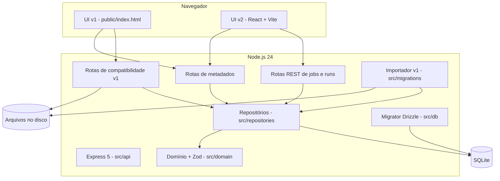
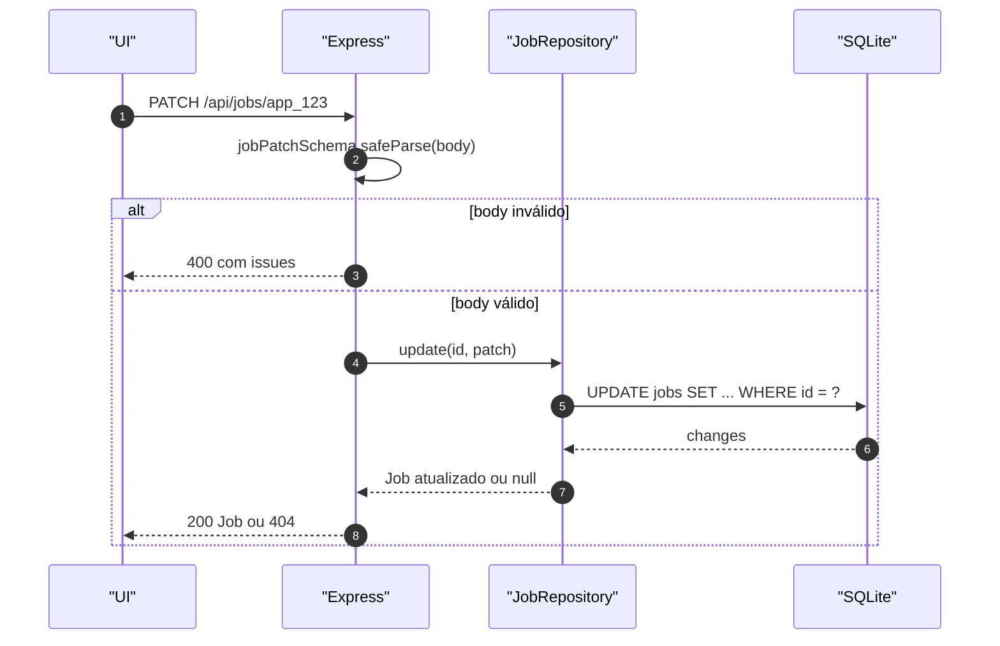
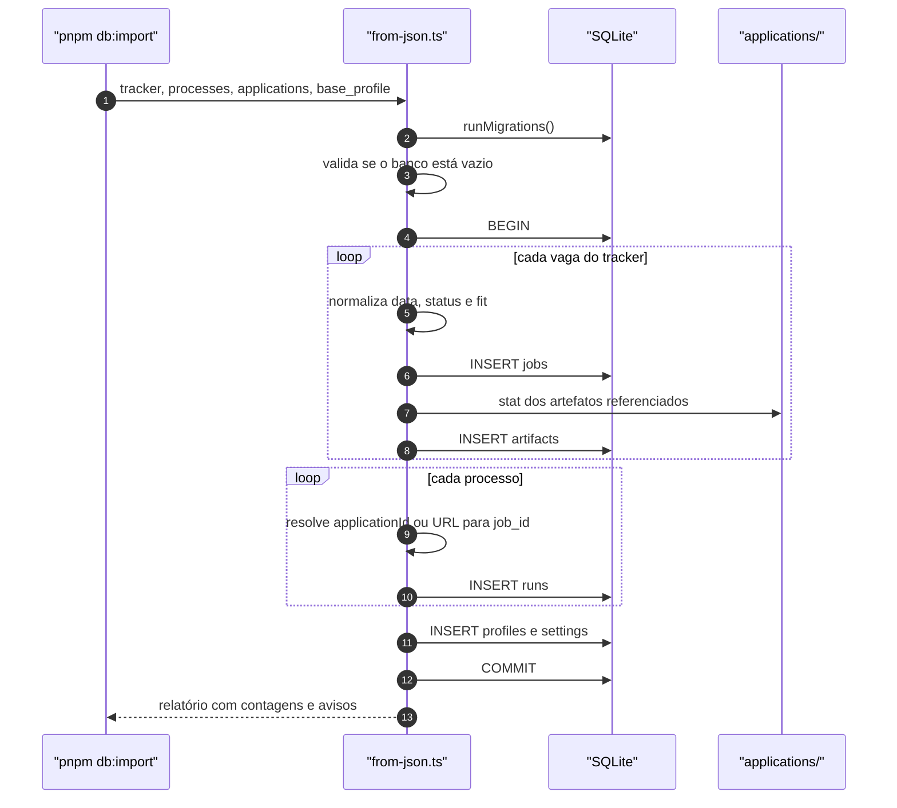
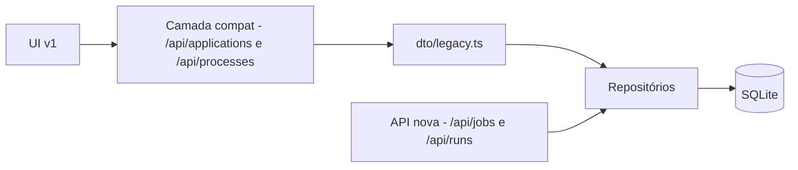
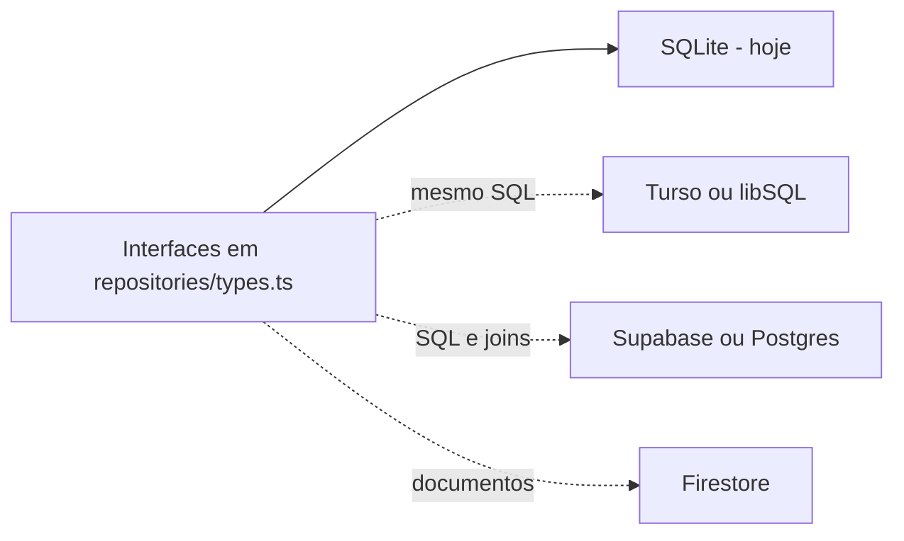

# Arquitetura

## 1. Visão geral

O v2 é uma aplicação **local-first** com três blocos:

1. **UI** — hoje a página vanilla do v1; a partir da Fase 2, um app React.
2. **API** — Express 5, dona da validação, regras de acesso e tradução de formatos.
3. **Persistência** — SQLite para dados estruturados e filesystem para artefatos gerados
   (PDF, HTML, TXT).

O pipeline pesado do v1 (Playwright, LLM, geração de PDF) **ainda não foi portado**; ele continua
no servidor antigo. O v2 hoje é a fonte de verdade dos dados de vagas, runs e artefatos.

## 2. Contexto



## 3. Containers



### Responsabilidades

| Componente | Responsabilidade | Não faz |
|---|---|---|
| `src/api` | HTTP, validação de entrada, status codes, DTOs | SQL, regra de negócio profunda |
| `src/domain` | Tipos, schemas Zod, datas, IDs | Acesso a banco |
| `src/repositories` | Contratos e implementação SQLite | HTTP, formatação de UI |
| `src/db` | Schema Drizzle, conexão, migrations | Regra de negócio |
| `src/migrations` | Importação one-off do v1 | Uso em runtime |
| `web/` (Fase 2) | UI React, cache de dados, navegação | Acesso direto ao SQLite |

## 4. Estrutura de pastas

```text
job-search-v2/
├── src/
│   ├── api/
│   │   ├── app.ts              # monta Express e middlewares
│   │   ├── server.ts           # bootstrap, porta, shutdown
│   │   ├── http.ts             # HttpError, parseBody, error handler
│   │   ├── dto/legacy.ts       # tradução para o formato do v1
│   │   └── routes/
│   │       ├── jobs.ts         # /api/jobs
│   │       ├── runs.ts         # /api/runs
│   │       ├── meta.ts         # perfis, settings, pdf-theme, candidate-data
│   │       ├── compat.ts       # /api/applications e /api/processes
│   │       └── viewers.ts      # /cv/:id e /extras/:id/:view
│   ├── domain/                 # Job, Run, Fit, Artifact, datas, IDs
│   ├── db/                     # schema, client SQLite, migrator
│   ├── repositories/           # interfaces + implementação SQLite
│   └── migrations/from-json.ts # importador do v1
├── drizzle/                    # migrations SQL geradas
├── test/                       # Vitest + Supertest
├── data/                       # SQLite local (gitignored)
└── docs/                       # esta documentação
```

## 5. Fluxo de leitura


## 6. Fluxo de escrita



## 7. Importação do v1



## 8. Estratégia de compatibilidade



A UI antiga não fala com o banco: ela fala com rotas que traduzem o domínio novo para o DTO antigo.
Quando o React assumir, a camada de compatibilidade pode ser removida sem tocar nos repositórios.

## 9. Evolução para nuvem



O modelo atual foi desenhado para tornar a troca barata: agregados em JSON, sem joins obrigatórios,
IDs estáveis e `owner_id` desde o início. Os detalhes estão no
[ADR-0002](./adr/0002-modelo-document-shaped.md) e no
[ADR-0003](./adr/0003-repository-pattern-e-nuvem.md).

## 10. Atributos de qualidade

| Atributo | Como é endereçado | Limite atual |
|---|---|---|
| Simplicidade | Um processo Node, um arquivo SQLite, sem infraestrutura | Não escala para múltiplos usuários simultâneos |
| Portabilidade | Repositórios + JSON columns + ISO + `owner_id` | DTO legado ainda acopla a UI v1 |
| Testabilidade | 63 testes, banco temporário por teste, Supertest | Pipeline pesado não testado no v2 |
| Segurança | Validação Zod, path traversal bloqueado, segredos fora do banco | Sem autenticação; assume uso local |
| Performance | Índices em status, data, empresa e job_id; WAL | Sem cache; N+1 na listagem de artefatos por vaga |
| Observabilidade | Logs de erro no handler global; health check | Sem métricas ou tracing |

## 11. Limites conhecidos

- O v2 **não executa** Playwright, chamadas de LLM nem geração de PDF.
- Não há autenticação; `owner_id` existe, mas é sempre `local`.
- A listagem de `/api/applications` faz uma consulta de artefatos por vaga (N+1). Para 16 vagas é
  irrelevante; será resolvido no React com um endpoint agregado ou `IN (...)`.
- A UI v1 ainda chama rotas de processamento que só existem no servidor antigo.

## 12. Decisões relacionadas

- [ADR-0001 — SQLite no backend](./adr/0001-sqlite-no-backend.md)
- [ADR-0002 — Modelo document-shaped](./adr/0002-modelo-document-shaped.md)
- [ADR-0003 — Repositórios e nuvem](./adr/0003-repository-pattern-e-nuvem.md)
- [ADR-0004 — Estratégia strangler](./adr/0004-estrategia-strangler-compatibilidade-v1.md)
- [ADR-0005 — Identidade, datas e nulos](./adr/0005-identidade-datas-e-nulos.md)
- [ADR-0006 — Artefatos no filesystem](./adr/0006-artefatos-no-filesystem.md)
- [ADR-0007 — Zod na borda](./adr/0007-zod-na-borda.md)
- [ADR-0008 — Vitest e Supertest](./adr/0008-vitest-supertest.md)
