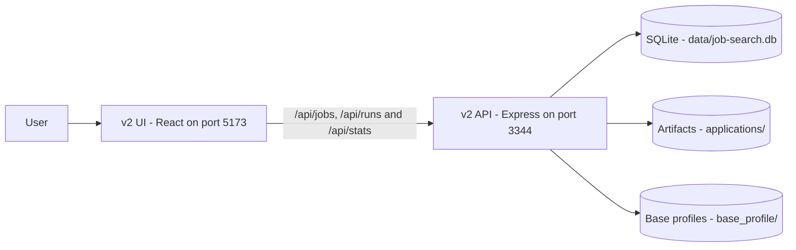
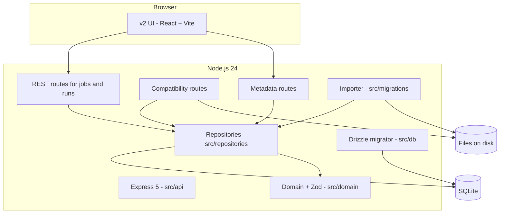
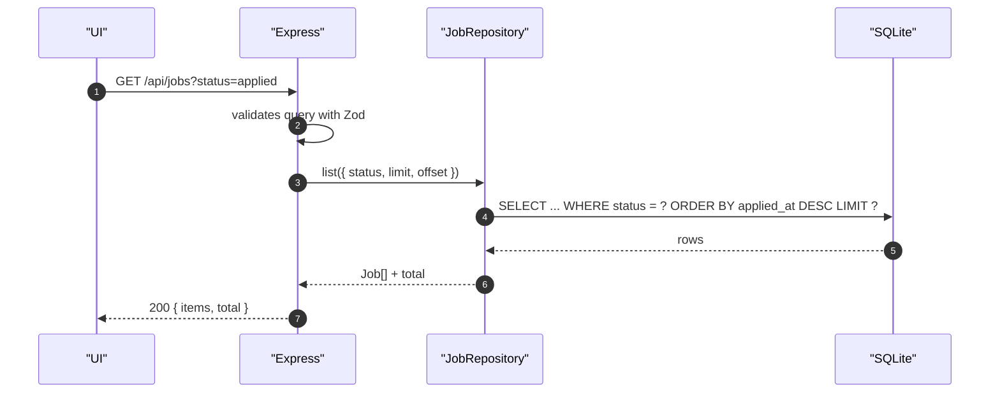
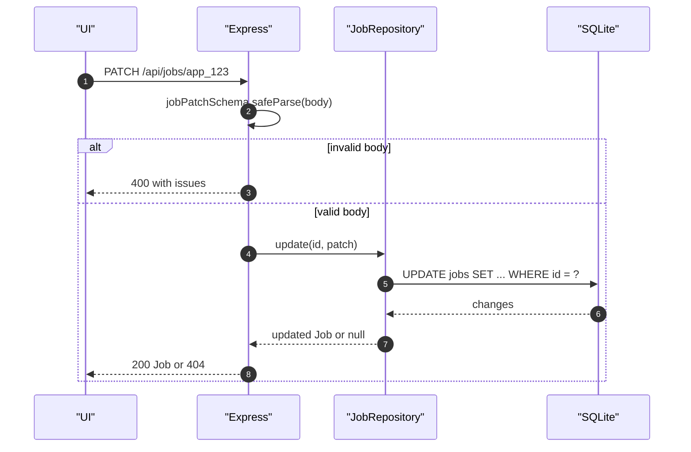
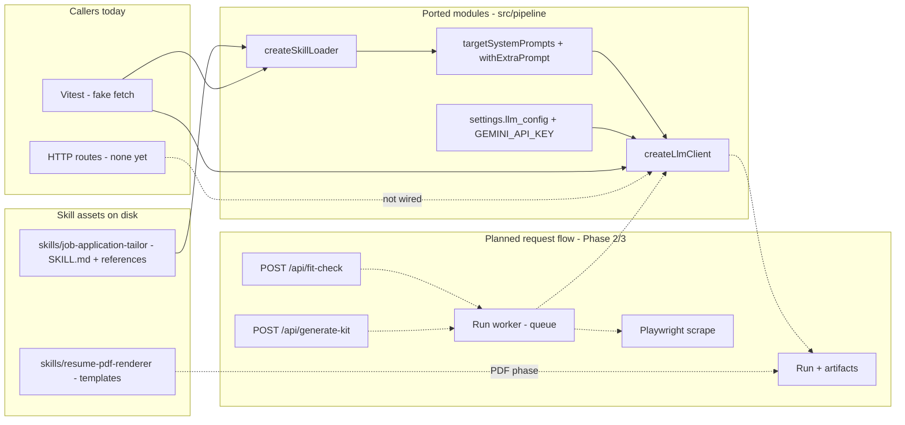
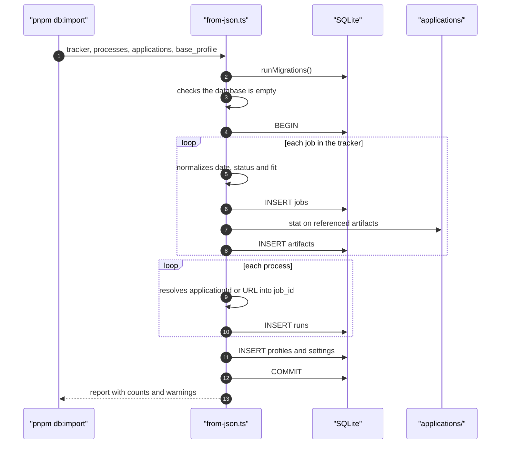
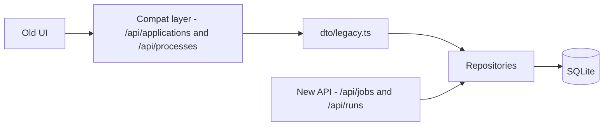

# Architecture

## 1. Overview

v2 is a **local-first** application with three blocks:

1. **UI** — a React SPA in `web/`, served by Express in production.
2. **API** — Express 5, owning validation, access rules and format translation.
3. **Persistence** — SQLite for structured data and the filesystem for generated artifacts
   (PDF, HTML, TXT).

The heavy pipeline (Playwright scraping, LLM fit and tailoring, PDF generation) is not fully
ported yet. The **LLM client**, the **LLM configuration** and the **skill prompt loader** already
live in `src/pipeline/`; scraping, fit-check, kit generation and PDF generation still run in the
previous server. v2 is today the source of truth for job, run and artifact data.

## 2. Context



This is the runtime of the app. Compatibility, the one-off import and the external pipeline are
covered in §9, §8 and §7.

## 3. Containers



### Responsibilities

| Component | Responsibility | Does not do |
|---|---|---|
| `src/api` | HTTP, input validation, status codes, DTOs | SQL, deep business logic |
| `src/domain` | Types, Zod schemas, dates, IDs | Database access |
| `src/repositories` | Contracts and SQLite implementation | HTTP, UI formatting |
| `src/db` | Drizzle schema, connection, migrations | Business logic |
| `src/migrations` | One-off import of existing data | Runtime usage |
| `web/` | React UI, data cache, navigation | Direct SQLite access |

## 4. Folder structure

```text
job-search-v2/
├── web/                        # React frontend (Vite + TanStack Query)
│   ├── src/
│   │   ├── api/                # client, types and hooks
│   │   ├── components/         # layout, fit, runs, artifacts
│   │   ├── pages/              # dashboard, detail, admin and app settings
│   │   └── lib/                # formatting and labels
│   └── dist/                   # build served by Express
├── src/
│   ├── api/
│   │   ├── app.ts              # mounts Express and middlewares
│   │   ├── server.ts           # bootstrap, port, shutdown
│   │   ├── http.ts             # HttpError, parseBody, error handler
│   │   ├── dto/legacy.ts       # translation to the compatibility format
│   │   └── routes/
│   │       ├── jobs.ts         # /api/jobs
│   │       ├── runs.ts         # /api/runs
│   │       ├── meta.ts         # profiles, settings, llm-config, pdf-theme, candidate-data
│   │       ├── compat.ts       # /api/applications and /api/processes
│   │       └── viewers.ts      # /cv/:id and /extras/:id/:view
│   ├── domain/                 # Job, Run, Fit, Artifact, LlmConfig, dates, IDs
│   ├── db/                     # schema, SQLite client, migrator
│   ├── repositories/           # interfaces + SQLite implementation
│   ├── pipeline/               # LLM client, LLM config and skill prompt loader
│   └── migrations/from-json.ts # importer
├── skills/                     # skill assets (SKILL.md + references/ + templates/)
├── drizzle/                    # generated SQL migrations
├── test/                       # Vitest + Supertest
├── data/                       # local SQLite (gitignored)
└── docs/                       # this documentation
```

## 5. Read flow



## 6. Write flow



## 7. Pipeline: LLM and skills

The pipeline building blocks that were ported live in `src/pipeline/` and consume the skill assets
in `skills/`. **No HTTP route calls the LLM yet**: in the current phase these modules are covered
by unit tests only. The previous server still performs scraping, fit-check and kit generation.



Solid edges are wired today; dotted edges are planned.

| Module | Responsibility |
|---|---|
| `src/pipeline/llm/client.ts` | `createLlmClient()` — non-streaming calls with retry/backoff (2 s / 6 s / 12 s) on 429, 5xx and transient errors; dispatch for Gemini, OpenAI/NVIDIA/OpenAI-compatible and Anthropic |
| `src/pipeline/llm/config.ts` | `loadLlmConfig()` / `saveLlmConfig()` — persists in `settings['llm_config']`, merges partial patches and falls back to `GEMINI_API_KEY` |
| `src/pipeline/skills/loader.ts` | `createSkillLoader()` — reads `SKILL.md` and `references/*.md` under `skills/job-application-tailor/`, caches them and builds the fit, tailor and email system prompts |
| `src/pipeline/prompts.ts` | `resolveTargetProfile()`, `withExtraPrompt()`, `targetSystemPrompts()` — only enabled targets participate and `extraPrompt` is appended as style guidance |
| `src/domain/llm.ts` | Provider enum, defaults, `llmConfigPatchSchema` and the public (masked) config shape |
| `src/api/routes/meta.ts` | `GET/PUT/POST /api/llm-config`; the key is never returned |

Planned flow (Phase 2–3): a route receives a fit or kit request → enqueues a run → the worker
scrapes the job, builds the target's system prompts (`targetSystemPrompts`) → calls
`createLlmClient().call(prompt, system)` → persists the run and artifacts. The full port map is in
`.plans/pipeline-port-v1-v2.md`; the current surface is in [api.md](./api.md) and the phase goals in
[roadmap.md](./roadmap.md).

## 8. Import of existing data



## 9. Compatibility strategy



The old UI doesn't talk to the database: it talks to routes that translate the new domain into the
old DTO. Once React takes over, the compatibility layer can be removed without touching the
repositories.

## 10. Quality attributes

| Attribute | How it is addressed | Current limit |
|---|---|---|
| Simplicity | One Node process, one SQLite file, no infrastructure | Doesn't scale to multiple concurrent users |
| Portability | Repositories + JSON columns + ISO + `owner_id` | The compatibility DTO still couples the old UI |
| Testability | 103 backend tests + 28 frontend tests; temporary database and Supertest | Scraping, fit-check and PDF generation are not covered |
| Security | Zod validation, path traversal blocked, LLM key masked by the API | No authentication; assumes local use |
| Performance | Indexes on status, date, company and job_id; WAL | No cache; N+1 when listing artifacts per job |
| Observability | Error logs in the global handler; health check | No metrics or tracing |

## 11. Known limits

- The runtime **does not run** Playwright scraping, LLM fit/tailoring or PDF generation yet. Only
  the LLM client, the LLM configuration and the skill prompt loader are ported.
- There is no authentication; `owner_id` exists but is always `local`.
- The `/api/applications` listing runs one artifact query per job (N+1). For 16 jobs it's
  irrelevant; it will be solved with an aggregate endpoint or `IN (...)`.
- The old UI still calls processing routes that only exist on the previous server.
- React covers dashboard, detail, admin and app settings.

## 12. Related decisions

- [ADR-0001 — SQLite in the backend](./adr/0001-sqlite-in-backend.md)
- [ADR-0002 — Document-shaped model](./adr/0002-document-shaped-model.md)
- [ADR-0003 — Repository pattern](./adr/0003-repository-pattern.md)
- [ADR-0004 — Strangler strategy](./adr/0004-strangler-strategy-v1-compatibility.md)
- [ADR-0005 — Identity, dates and nulls](./adr/0005-identity-datas-and-nulls.md)
- [ADR-0006 — Artifacts on the filesystem](./adr/0006-artifacts-on-the-filesystem.md)
- [ADR-0007 — Zod at the boundary](./adr/0007-zod-at-the-http-boundary.md)
- [ADR-0008 — Vitest and Supertest](./adr/0008-vitest-supertest.md)
