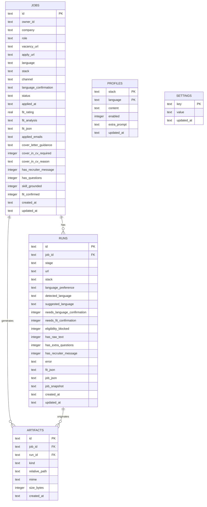
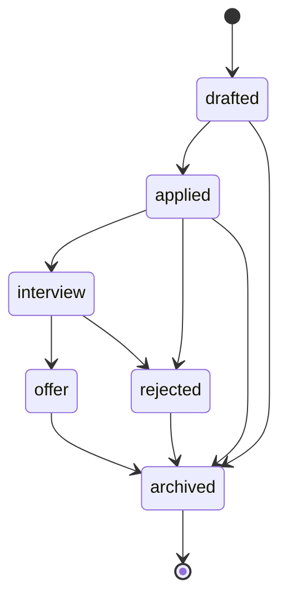

# Data model

## 1. Entity-relationship diagram



## 2. Tables

### `jobs`

One row per job/application. It is the **single source of truth** for company, role, status,
language, stack and fit analysis.

| Column | Type | Notes |
|---|---|---|
| `id` | TEXT PK | `app_` + UUID |
| `owner_id` | TEXT | Default `local`; ready for auth |
| `company`, `role` | TEXT | Required |
| `vacancy_url`, `apply_url` | TEXT | Original URLs |
| `language` | TEXT | `pt-br` or `en` |
| `stack` | TEXT | `ruby`, `php` etc. |
| `channel` | TEXT | `linkedin`, `portal`, `email`… |
| `language_confirmation` | TEXT | Preserves v1's `user-confirmed` |
| `status` | TEXT | `drafted`, `applied`, `interview`, `offer`, `rejected`, `archived` |
| `applied_at` | TEXT | ISO 8601 UTC |
| `fit_rating` | REAL | Indexable copy of `fit.rating` |
| `fit_analysis` | TEXT | Indexable copy of `fit.analysis` |
| `fit_json` | TEXT JSON | Full `Fit` object |
| `applied_emails` | TEXT JSON | Array of emails used |
| `cover_letter_guidance` | TEXT | Instructions for the letter |
| `cover_in_cv_required` | INTEGER bool | Whether the job asks for a cover in the CV |
| `cover_in_cv_reason` | TEXT | Justification |
| `has_recruiter_message` | INTEGER bool | A recruiter message exists |
| `has_questions` | INTEGER bool | Extra questions exist |
| `skill_grounded` | INTEGER bool | Analysis based only on the profile |
| `fit_confirmed` | INTEGER bool | Fit confirmed by the user |
| `created_at`, `updated_at` | TEXT | ISO 8601 UTC |

### `runs`

Checkpoint of a processing run (scraping, fit, generation). A job can have several runs.

| Column | Type | Notes |
|---|---|---|
| `id` | TEXT PK | `proc_` + UUID |
| `job_id` | TEXT FK | `ON DELETE SET NULL`; orphan runs are valid |
| `stage` | TEXT | `draft`, `fit-checked`, `processing`, `done`, `error`… |
| `url` | TEXT | Processed URL |
| `stack` | TEXT | Stack used in the run |
| `language_preference` | TEXT | Chosen language |
| `detected_language` | TEXT | Detected language |
| `suggested_language` | TEXT | Suggested language |
| `needs_language_confirmation` | INTEGER bool | Awaiting confirmation |
| `needs_fit_confirmation` | INTEGER bool | Awaiting fit confirmation |
| `eligibility_blocked` | INTEGER bool | Blocked by eligibility |
| `has_raw_text` | INTEGER bool | Raw text available |
| `has_extra_questions` | INTEGER bool | Extra questions available |
| `has_recruiter_message` | INTEGER bool | Recruiter message available |
| `error` | TEXT | Run error |
| `fit_json` | TEXT JSON | Run's fit |
| `job_json` | TEXT JSON | Job metadata at run time |
| `job_snapshot` | TEXT JSON | Full snapshot, including `content` |
| `created_at`, `updated_at` | TEXT | ISO 8601 UTC |

### `artifacts`

Metadata of generated files. **The content does not live in the database.**

| Column | Type | Notes |
|---|---|---|
| `id` | TEXT PK | `art_` + UUID |
| `job_id` | TEXT FK | `ON DELETE CASCADE` |
| `run_id` | TEXT FK | `ON DELETE SET NULL` |
| `kind` | TEXT | `cv_pdf`, `cv_html`, `email_text`, `recruiter_note`… |
| `relative_path` | TEXT | Relative to `applications/` |
| `mime` | TEXT | E.g.: `application/pdf` |
| `size_bytes` | INTEGER | Size at import time |
| `created_at` | TEXT | ISO 8601 UTC |

A unique index on `(job_id, kind, relative_path)` prevents duplicates on re-import.

### `profiles`

Application targets per stack and language. Each row combines `(stack, language)` and keeps the
base resume in `content` (v1's original JSON + `rawText` edited in v2).

| Column | Type | Notes |
|---|---|---|
| `stack` | TEXT PK | Slug (`ruby`, `php`, `elixir`…); `^[a-z][a-z0-9-]{0,31}$` |
| `language` | TEXT PK | `pt-br` or `en` |
| `content` | TEXT JSON | Base resume; `null` while there is no text |
| `enabled` | INTEGER bool | Default `true`; targets imported from v1 stay active |
| `extra_prompt` | TEXT | Extra instructions for the fit/tailor prompts; `null` if empty |
| `updated_at` | TEXT | ISO 8601 UTC |

The extra text is a **style/emphasis instruction**, never a source of facts: grounding stays in the
base resume. The pipeline (Phase 3) should only consider targets with `enabled = true`.

### `settings`

Key/value pairs for PDF theme, computed profile and form data. API keys **do not** go here.

## 3. Nested JSONs

### `Fit`

```json
{
  "rating": 77.5,
  "analysis": "Forte aderência em Ruby on Rails.",
  "dimensions": {
    "skillsMatch": 60,
    "experienceMatch": 85,
    "logisticsMatch": 95,
    "cultureMatch": 90
  },
  "strengths": ["Rails", "PostgreSQL"],
  "gaps": ["Node.js"],
  "eligibility": { "passed": true, "reason": "Trabalho remoto." },
  "languageGate": { "required": "en", "passed": true, "note": "Inglês profissional." },
  "logisticsNote": null
}
```

### `JobSnapshot`

```json
{
  "title": "Senior Backend Software Engineer",
  "company": "Andela",
  "location": "Remote",
  "url": "https://example.com/job/1",
  "applyUrl": "https://example.com/job/1/apply",
  "detectedLanguage": "en",
  "content": "Texto completo da vaga...",
  "extraQuestions": "Perguntas do formulário...",
  "recruiterMessage": "Mensagem do recrutador..."
}
```

`content` can be large; that's why the snapshot lives in a JSON column and is not loaded in
listings.

## 4. Indexes

| Index | Table | Reason |
|---|---|---|
| `jobs_owner_idx` | `jobs(owner_id)` | Future per-user filtering |
| `jobs_status_idx` | `jobs(status)` | Dashboard filter |
| `jobs_applied_at_idx` | `jobs(applied_at)` | Sorting and statistics |
| `jobs_company_idx` | `jobs(company)` | Text search |
| `runs_job_idx` | `runs(job_id)` | Runs of a job |
| `runs_stage_idx` | `runs(stage)` | Checkpoint queue |
| `artifacts_job_idx` | `artifacts(job_id)` | Artifacts of a job |
| `artifacts_kind_idx` | `artifacts(kind)` | Filter by type |
| `artifacts_job_kind_path_uq` | `artifacts(job_id, kind, relative_path)` | Deduplication |

## 5. Invariants

1. `jobs.id` is immutable.
2. `runs.job_id` may be `null`; it never points to a nonexistent job.
3. `artifacts.job_id` always exists; removing the job drops the artifacts via cascade.
4. `artifacts.relative_path` never starts with `/` and never leaves `applications/`.
5. `applied_at`, `created_at` and `updated_at` are ISO 8601.
6. Optional fields are `null`, not `undefined`.
7. `status` belongs to the domain enum.

## 6. Status lifecycle



The database doesn't enforce the state machine; value validation is done by Zod in the API.
Invalid transitions are still possible via a direct `PATCH` — a conscious decision for local use.

## 7. Mapping to Firestore

| SQLite | Firestore |
|---|---|
| `jobs` | `jobs` collection, one document per `id` |
| `runs` | `runs` collection, with a `jobId` field (or subcollection) |
| `artifacts` | `artifacts` collection; file in Cloud Storage |
| `profiles` | `profiles` collection, doc `stack__language` |
| `settings` | `settings` collection, doc per key |
| `fit_json` | `fit` field (map) |
| `job_snapshot` | `jobSnapshot` field (map) |
| `owner_id` | `ownerId` field + security rules |

No joins: listing artifacts per job becomes a query by `jobId` (or an array of references in the
job document, if the read always happens together).

## 8. Migrations

- Generated by `drizzle-kit` from `src/db/schema.ts`.
- Versioned in `drizzle/`.
- Applied by `pnpm db:migrate` or automatically on API boot.
- `drizzle/meta/_journal.json` records the order; don't edit already-applied migrations.

| Migration | Content |
|---|---|
| `0000_init.sql` | Creates the five tables and indexes |
| `0001_compat_fields.sql` | Adds `language_confirmation`, `runs.stack` and `runs.job_json` |
| `0002_profile_targets.sql` | Adds `profiles.enabled` and `profiles.extra_prompt` |
