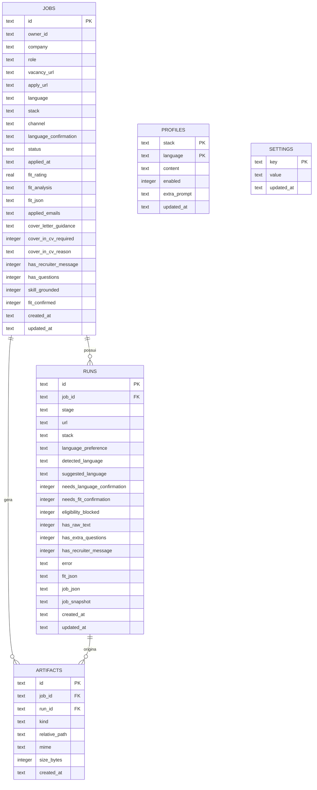
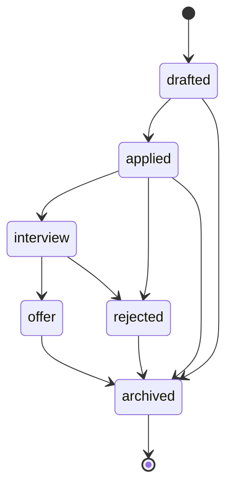

# Modelo de dados

## 1. Diagrama entidade-relacionamento



## 2. Tabelas

### `jobs`

Uma linha por vaga/candidatura. É a **fonte única de verdade** para empresa, cargo, status,
idioma, stack e análise de aderência.

| Coluna | Tipo | Observação |
|---|---|---|
| `id` | TEXT PK | `app_` + UUID |
| `owner_id` | TEXT | Default `local`; preparado para auth |
| `company`, `role` | TEXT | Obrigatórios |
| `vacancy_url`, `apply_url` | TEXT | URLs originais |
| `language` | TEXT | `pt-br` ou `en` |
| `stack` | TEXT | `ruby`, `php` etc. |
| `channel` | TEXT | `linkedin`, `portal`, `email`… |
| `language_confirmation` | TEXT | Preserva `user-confirmed` do v1 |
| `status` | TEXT | `drafted`, `applied`, `interview`, `offer`, `rejected`, `archived` |
| `applied_at` | TEXT | ISO 8601 UTC |
| `fit_rating` | REAL | Cópia indexável de `fit.rating` |
| `fit_analysis` | TEXT | Cópia indexável de `fit.analysis` |
| `fit_json` | TEXT JSON | Objeto `Fit` completo |
| `applied_emails` | TEXT JSON | Array de e-mails usados |
| `cover_letter_guidance` | TEXT | Instruções para a carta |
| `cover_in_cv_required` | INTEGER bool | Se a vaga pede cover no CV |
| `cover_in_cv_reason` | TEXT | Justificativa |
| `has_recruiter_message` | INTEGER bool | Existe mensagem de recrutador |
| `has_questions` | INTEGER bool | Existem perguntas extras |
| `skill_grounded` | INTEGER bool | Análise baseada apenas no perfil |
| `fit_confirmed` | INTEGER bool | Fit confirmado pelo usuário |
| `created_at`, `updated_at` | TEXT | ISO 8601 UTC |

### `runs`

Checkpoint de um processamento (raspagem, fit, geração). Um job pode ter vários runs.

| Coluna | Tipo | Observação |
|---|---|---|
| `id` | TEXT PK | `proc_` + UUID |
| `job_id` | TEXT FK | `ON DELETE SET NULL`; runs órfãos são válidos |
| `stage` | TEXT | `draft`, `fit-checked`, `processing`, `done`, `error`… |
| `url` | TEXT | URL processada |
| `stack` | TEXT | Stack usada no run |
| `language_preference` | TEXT | Idioma escolhido |
| `detected_language` | TEXT | Idioma detectado |
| `suggested_language` | TEXT | Idioma sugerido |
| `needs_language_confirmation` | INTEGER bool | Aguarda confirmação |
| `needs_fit_confirmation` | INTEGER bool | Aguarda confirmação do fit |
| `eligibility_blocked` | INTEGER bool | Bloqueado por elegibilidade |
| `has_raw_text` | INTEGER bool | Texto bruto disponível |
| `has_extra_questions` | INTEGER bool | Perguntas extras disponíveis |
| `has_recruiter_message` | INTEGER bool | Mensagem de recrutador disponível |
| `error` | TEXT | Erro do run |
| `fit_json` | TEXT JSON | Fit do run |
| `job_json` | TEXT JSON | Metadados da vaga no momento do run |
| `job_snapshot` | TEXT JSON | Snapshot completo, incluindo `content` |
| `created_at`, `updated_at` | TEXT | ISO 8601 UTC |

### `artifacts`

Metadados dos arquivos gerados. **O conteúdo não fica no banco.**

| Coluna | Tipo | Observação |
|---|---|---|
| `id` | TEXT PK | `art_` + UUID |
| `job_id` | TEXT FK | `ON DELETE CASCADE` |
| `run_id` | TEXT FK | `ON DELETE SET NULL` |
| `kind` | TEXT | `cv_pdf`, `cv_html`, `email_text`, `recruiter_note`… |
| `relative_path` | TEXT | Relativo a `applications/` |
| `mime` | TEXT | Ex.: `application/pdf` |
| `size_bytes` | INTEGER | Tamanho no momento da importação |
| `created_at` | TEXT | ISO 8601 UTC |

Índice único em `(job_id, kind, relative_path)` impede duplicatas na reimportação.

### `profiles`

Alvos de candidatura por stack e idioma. Cada linha combina `(stack, language)` e guarda o
currículo base em `content` (JSON original do v1 + `rawText` editado no v2).

| Coluna | Tipo | Observação |
|---|---|---|
| `stack` | TEXT PK | Slug (`ruby`, `php`, `elixir`…); `^[a-z][a-z0-9-]{0,31}$` |
| `language` | TEXT PK | `pt-br` ou `en` |
| `content` | TEXT JSON | Currículo base; `null` enquanto não houver texto |
| `enabled` | INTEGER bool | Default `true`; alvos importados do v1 continuam ativos |
| `extra_prompt` | TEXT | Instruções extras para os prompts de fit/tailor; `null` se vazio |
| `updated_at` | TEXT | ISO 8601 UTC |

O texto extra é **instrução de estilo/ênfase**, nunca fonte de fatos: o grounding continua no
currículo base. O pipeline (Fase 3) deve considerar apenas alvos com `enabled = true`.

### `settings`

Pares chave/valor para tema de PDF, perfil calculado e dados de formulário. Chaves de API **não**
entram aqui.

## 3. JSONs aninhados

### `Fit`

```json
{
  "rating": 77.5,
  "analysis": "Forte aderência em Ruby on Rails.",
  "dimensions": {
    "skillsMatch": 60,
    "experienceMatch": 85,
    "logisticsMatch": 95,
    "cultureMatch": 90
  },
  "strengths": ["Rails", "PostgreSQL"],
  "gaps": ["Node.js"],
  "eligibility": { "passed": true, "reason": "Trabalho remoto." },
  "languageGate": { "required": "en", "passed": true, "note": "Inglês profissional." },
  "logisticsNote": null
}
```

### `JobSnapshot`

```json
{
  "title": "Senior Backend Software Engineer",
  "company": "Andela",
  "location": "Remote",
  "url": "https://example.com/job/1",
  "applyUrl": "https://example.com/job/1/apply",
  "detectedLanguage": "en",
  "content": "Texto completo da vaga...",
  "extraQuestions": "Perguntas do formulário...",
  "recruiterMessage": "Mensagem do recrutador..."
}
```

`content` pode ser grande; por isso o snapshot fica em uma coluna JSON e não é carregado em
listagens.

## 4. Índices

| Índice | Tabela | Motivo |
|---|---|---|
| `jobs_owner_idx` | `jobs(owner_id)` | Futuro filtro por usuário |
| `jobs_status_idx` | `jobs(status)` | Filtro do dashboard |
| `jobs_applied_at_idx` | `jobs(applied_at)` | Ordenação e estatísticas |
| `jobs_company_idx` | `jobs(company)` | Busca textual |
| `runs_job_idx` | `runs(job_id)` | Runs de uma vaga |
| `runs_stage_idx` | `runs(stage)` | Fila de checkpoints |
| `artifacts_job_idx` | `artifacts(job_id)` | Artefatos de uma vaga |
| `artifacts_kind_idx` | `artifacts(kind)` | Filtro por tipo |
| `artifacts_job_kind_path_uq` | `artifacts(job_id, kind, relative_path)` | Deduplicação |

## 5. Invariantes

1. `jobs.id` é imutável.
2. `runs.job_id` pode ser `null`; nunca aponta para job inexistente.
3. `artifacts.job_id` sempre existe; ao remover o job, os artefatos caem por cascade.
4. `artifacts.relative_path` nunca começa com `/` e nunca sai de `applications/`.
5. `applied_at`, `created_at` e `updated_at` são ISO 8601.
6. Campos opcionais são `null`, não `undefined`.
7. `status` pertence ao enum do domínio.

## 6. Ciclo de vida do status



O banco não impõe a máquina de estados; a validação de valores é feita por Zod na API. Transições
inválidas ainda são possíveis via `PATCH` direto — decisão consciente para uso local.

## 7. Mapeamento para Firestore

| SQLite | Firestore |
|---|---|
| `jobs` | coleção `jobs`, documento por `id` |
| `runs` | coleção `runs`, com campo `jobId` (ou subcoleção) |
| `artifacts` | coleção `artifacts`; arquivo no Cloud Storage |
| `profiles` | coleção `profiles`, doc `stack__language` |
| `settings` | coleção `settings`, doc por chave |
| `fit_json` | campo `fit` (map) |
| `job_snapshot` | campo `jobSnapshot` (map) |
| `owner_id` | campo `ownerId` + regras de segurança |

Sem joins: a listagem de artefatos por job vira uma consulta por `jobId` (ou um array de
referências no documento do job, se a leitura for sempre junto).

## 8. Migrations

- Geradas por `drizzle-kit` a partir de `src/db/schema.ts`.
- Versionadas em `drizzle/`.
- Aplicadas por `pnpm db:migrate` ou automaticamente no boot da API.
- `drizzle/meta/_journal.json` registra a ordem; não edite migrations já aplicadas.

| Migration | Conteúdo |
|---|---|
| `0000_init.sql` | Cria as cinco tabelas e índices |
| `0001_compat_fields.sql` | Adiciona `language_confirmation`, `runs.stack` e `runs.job_json` |
| `0002_profile_targets.sql` | Adiciona `profiles.enabled` e `profiles.extra_prompt` |
