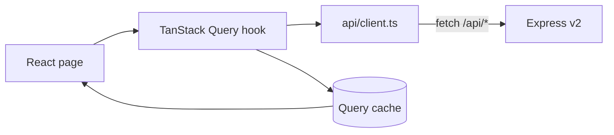

# Frontend (React)

## 1. Stack

| Item | Choice | Role |
|---|---|---|
| Build | Vite 6 | Dev server, proxy and production build |
| UI | React 19 | Components and local state |
| Routes | React Router 7 | Dashboard and job detail |
| Data | TanStack Query 5 | Cache, loading/error, invalidation |
| Types | TypeScript 5.9 | Contract with the API |
| Tests | Vitest 4 + Testing Library | Components and data flow |

The app lives in `web/` and is a pnpm workspace package.

## 2. Structure

```text
web/
├── index.html
├── vite.config.ts          # /api proxy and Vitest configuration
├── src/
│   ├── main.tsx            # QueryClient + BrowserRouter
│   ├── App.tsx             # routes
│   ├── styles.css          # dark theme, layout and components
│   ├── api/
│   │   ├── types.ts        # mirror of the domain types
│   │   ├── client.ts       # fetch + ApiError + query string
│   │   └── hooks.ts        # useStats, useJobs, useJob, useUpdateJob
│   ├── components/         # Layout, badges, fit, runs, artifacts, states
│   ├── lib/format.ts       # dates, fit, bytes, labels and URLs
│   ├── pages/              # Dashboard, JobDetail, Admin, AppSettings, NotFound
│   └── test/               # setup and renderWithProviders
└── dist/                   # build (gitignored)
```

## 3. Routes

| Route | Page | Source |
|---|---|---|
| `/` | Dashboard | `GET /api/stats` + `GET /api/jobs` (filters in the query string) |
| `/jobs/:id` | Job detail | `GET /api/jobs/:id` |
| `/admin` | PDF appearance and form data | `GET/PUT` of pdf-theme and candidate-data |
| `/admin/settings` | App Settings (targets and base resumes) | `GET/POST/PUT/DELETE` of profiles |
| `*` | Not found | — |

Dashboard filters and pagination live in the URL (`?q=`, `?status=`, `?page=`), so filtered links
are shareable and the browser back button works. The search is written to the URL with `replace`
so keystrokes don't pile up history; `page` resets when `q` or `status` changes. The list uses 25
items per page.

## 4. Data flow



- `useStats` → key `['stats']`
- `useJobs(filters)` → key `['jobs', filters]`, with `keepPreviousData` so the table doesn't flash
  when filtering
- `useJob(id)` → key `['job', id]`; refetches every **4 s** while there is an active run (stage
  different from `done`/`error`) or a pending confirmation
- `useUpdateJob` → `PATCH /api/jobs/:id`; on success updates the detail cache and invalidates
  `['jobs']` and `['stats']`
- `useProfiles` → `GET /api/profiles` (targets, including `enabled` and `extraPrompt`)
- `useSaveProfile` → `PUT /api/profiles/:stack/:language` with a partial patch
- `useCreateProfile` → `POST /api/profiles`; `useDeleteProfile` → `DELETE /api/profiles/:stack/:language`
  (all three mutations invalidate `['profiles']` and `['base-resumes']`)
- `usePdfTheme` / `useSavePdfTheme` → `GET/PUT /api/pdf-theme`
- `useCandidateData` / `useSaveCandidateData` → `GET/PUT /api/candidate-data`

HTTP errors become an `ApiError` with `status` and the backend's message. The detail page uses the
`404` status to distinguish "job not found" from a generic failure.

## 5. Components

| Component | Responsibility |
|---|---|
| `Layout` | Topbar, navigation and footer |
| `Dashboard` | Stats, search, filter, table and pagination |
| `JobDetail` | Header, status change, fit, runs, artifacts and summary |
| `FitPanel` | Rating, analysis, dimensions, strengths, gaps and eligibility |
| `RunList` | Checkpoints with stage, flags and expandable snapshot |
| `ArtifactList` | One link per type, pointing to the right viewer |
| `StatusBadge` | Colors and labels per status |
| `StateMessage` | Loading, error with retry and empty |
| `Admin` | PDF appearance, form data and link to App Settings |
| `AppSettings` | New-target form and a list of cards per stack × language |
| `TargetCard` | Base resume, extra instructions, activation and removal of a target |

`ArtifactList` deduplicates by `kind` (keeping the most recent) and sorts by relevance. The links
use the backend viewers:

- CV → `/cv/:jobId`
- email → `/extras/:jobId/email`
- recruiter/LinkedIn → `/extras/:jobId/recruiter`
- questions/suggestions → `/extras/:jobId/suggestions`
- everything else → `/applications/<relativePath>`

## 6. Development

Two terminals:

```bash
# terminal 1 — API
pnpm dev

# terminal 2 — Vite
pnpm dev:web
```

Vite runs at `http://localhost:5173` and proxies `/api`, `/applications`, `/base_profile`, `/cv`
and `/extras` to `http://localhost:3344`.

## 7. Production

```bash
pnpm build:web
pnpm start
```

Express serves `web/dist` on the same port as the API (`3344`) and falls back to `index.html` for
navigation routes. The `/api`, `/applications`, `/base_profile`, `/cv` and `/extras` prefixes do
**not** hit the fallback, so a missing artifact keeps returning `404` instead of HTML.

`WEB_DIST` allows pointing at a different build directory.

## 8. Tests

```bash
pnpm test:web          # 28 tests
pnpm typecheck:web
pnpm build:web
```

They cover:

- Formatting of dates, fit, bytes, labels and artifact URLs.
- Dashboard: stats, table, status filter, search, empty, error with retry, filters/page from the
  URL and pagination navigation.
- Runs: detection of an active run and pending confirmation (used by the polling).
- Detail: fit, runs, artifacts, status change via `PATCH`, updating indicator and `404`.
- App Settings: listing, creation (`POST`), saving resume + `extraPrompt` in a single `PUT`,
  deactivation, removal (`DELETE`) and duplicate error (`409`).
- Admin: link to App Settings, saving PDF colors and saving form data.

`fetch` is mocked per test; there is no need to run the API. See [testing.md](./testing.md).

## 9. Decisions

- **No Redux/Zustand.** The TanStack Query cache covers server state; the rest is local.
- **No UI library.** Own CSS to keep the bundle small and the look close to v1.
- **No `dangerouslySetInnerHTML`.** Job content and messages are rendered as text.
- **Filters and page in the URL.** Filtered links are shareable; the search uses `replace` to keep
  the history clean.
- **One workspace package.** `web/` has isolated scripts and dependencies.
- **Configurable targets in App Settings.** Each target is a row in `profiles` (`stack × language`),
  editable in the UI: base resume, extra instructions, enable/disable and remove. Full description
  in [ADR-0009](./adr/0009-configurable-targets.md).
- **Admin edits text, not PDF.** Upload with PDF extraction depends on v1's pipeline; in v2 the
  page accepts `.txt`, `.md` and `.html` (read in the browser) or pasted text, and saves via
  `PUT /api/profiles/:stack/:language`.

## 10. Next steps

1. Checkpoint response inside v2 (depends on porting the pipeline).
2. Optimistic status updates.
3. Resume upload with PDF extraction (depends on the pipeline).
4. Retire the v1 UI for good and remove the compatibility routes.
