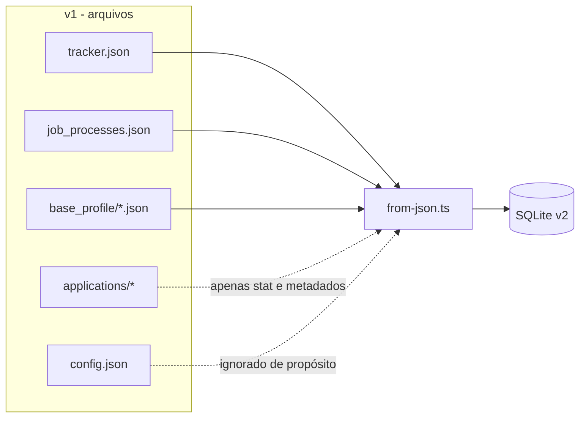

# Migração v1 → v2

## 1. Estratégia

O v1 guardava tudo em arquivos JSON no diretório `../job-search`:

| Arquivo | Conteúdo |
|---|---|
| `job_tracker.json` (ou similar) | Vagas/candidaturas |
| `job_processes.json` | Checkpoints de processamento |
| `base_profile/*.json` | Currículos base extraídos |
| `config.json` | Configuração, incluindo chave de LLM |
| `applications/<slug>/*` | PDFs, HTMLs, textos e JSONs gerados |

O v2 não lê esses arquivos em runtime. A migração é um **importador one-off** (`src/migrations/from-json.ts`)
que roda antes da aplicação subir e grava tudo no SQLite. O v1 permanece intacto como fallback.



## 2. Como rodar

```bash
# 1. Garanta que o banco está no schema mais recente
pnpm db:migrate

# 2. Importe (o banco precisa estar vazio)
pnpm db:import -- --tracker ../job-search

# Ou limpe e reimporte
pnpm db:import -- --reset
```

Opções aceitas pelo script (via `parseArgs`):

| Flag | Default | Descrição |
|---|---|---|
| `--tracker` | `../job-search` | Diretório do v1 |
| `--db` | `data/job-search.db` | Banco de destino |
| `--reset` | `false` | Apaga jobs/runs/artifacts antes de importar |

O importador abre uma transação única: ou tudo entra, ou nada entra. Ao final imprime um relatório
com contagens e avisos.

## 3. Resultado da importação real

```text
Importação concluída:
  vagas:     16
  processos: 34 (17 sem vaga)
  artefatos: 97
  perfis:    4
  settings:  2
```

### Avisos esperados

- `config.json não importado de propósito: contém chave de API da LLM.`
- `17 processo(s) sem vaga correspondente (jobId nulo).`

Os runs órfãos não são erro: são checkpoints antigos cuja vaga foi removida no v1. Eles continuam
válidos e aparecem em `/api/runs`; a UI do v1 não os mostra porque filtra `stage != done`.

## 4. Mapeamento de campos

### Vaga → `jobs`

| v1 | v2 | Transformação |
|---|---|---|
| `id` | `id` | Mantido quando já tem prefixo; senão gera `app_<uuid>` |
| `date` | `appliedAt` | `dd/mm/yyyy` → ISO 8601 UTC |
| `company` | `company` | Trim |
| `role` | `role` | Trim |
| `language` | `language` | `en` ou `pt-br` |
| `languageConfirmation` | `languageConfirmation` | Preservado (`user-confirmed`) |
| `stack` | `stack` | Lowercase; default `ruby` |
| `channel` | `channel` | Direto |
| `status` | `status` | Normalizado para o enum novo (ver abaixo) |
| `fitRating`, `fitAnalysis`, `strengths`, `gaps` | `fit` | Agrupados no objeto `Fit` |
| `fitDimensions` | `fit.dimensions` | Direto |
| `eligibility`, `languageGate`, `logisticsNote` | `fit.*` | Direto |
| `vacancyUrl`, `applyUrl` | `vacancyUrl`, `applyUrl` | Direto |
| `appliedEmails` | `appliedEmails` | Array JSON |
| `coverInCvRequired`, `coverInCvReason`, `coverLetterGuidance` | idem | Direto |
| `hasRecruiterMessage`, `hasQuestions`, `skillGrounded`, `fitConfirmed` | idem | Booleanos |

### Normalização de status

| v1 | v2 |
|---|---|
| `rascunho`, `drafted` | `drafted` |
| `aplicado`, `applied` | `applied` |
| `entrevista`, `interview` | `interview` |
| `proposta`, `offer` | `offer` |
| `encerrado`, `closed`, `desistido`, `rejected` | `rejected` |
| `arquivado`, `archived` | `archived` |

Status desconhecido gera aviso e cai em `drafted`. A mesma tabela é usada em tempo de execução pelo
DTO de compatibilidade.

### Processo → `runs`

| v1 | v2 |
|---|---|
| `id` | `id` (`proc_`) |
| `applicationId` | `jobId` (nulo se a vaga não existir) |
| `stage` | `stage` |
| `url` | `url` |
| `stack` | `stack` |
| `languagePreference`, `detectedLanguage`, `suggestedLanguage` | idem |
| `needsLanguageConfirmation`, `needsFitConfirmation`, `eligibilityBlocked` | idem |
| `hasRawText`, `hasExtraQuestions`, `hasRecruiterMessage` | idem |
| `error` | `error` |
| `fit` | `fit` (achatado → objeto) |
| `job` | `job` (metadados) |
| `jobSnapshot` | `jobSnapshot` (inclui `content`, `extraQuestions`, `recruiterMessage`) |
| `createdAt` | `createdAt` (normalizado para ISO) |

### Artefatos

O v1 referenciava arquivos por caminho dentro de `applications/`. O importador:

1. extrai o caminho relativo de cada referência;
2. verifica se o arquivo existe no disco (`fs.stat`);
3. grava `kind`, `relativePath`, `mime`, `sizeBytes` e `createdAt`.

**O conteúdo nunca é copiado para o banco.** Se o arquivo não existe, o artefato é importado
mesmo assim? Não — referências quebradas são registradas como aviso e omitidas, para o banco não
prometer arquivos inexistentes.

O índice único `(job_id, kind, relative_path)` garante que reimportar não duplica.

### Perfis e settings

- `base_profile/*.json` → `profiles`, com `content` guardando o JSON original.
- `pdf_theme` e `candidate_form` → `settings`.

## 5. O que deliberadamente não foi importado

| Item | Motivo |
|---|---|
| `config.json` / chave de LLM | Segredo. Reconfigurar no v2 via variável de ambiente |
| Conteúdo dos artefatos | Ficam no filesystem; o banco só guarda metadados |
| Caches e arquivos temporários | Sem valor histórico |
| Logs do v1 | Não fazem parte do domínio |

## 6. Validação pós-importação

O smoke test usado na migração real:

```bash
pnpm dev &   # sobe na 3344
curl -s localhost:3344/api/stats
curl -s localhost:3344/api/applications | head -c 500
curl -s localhost:3344/api/processes
curl -s localhost:3344/cv/<id> | head
```

Resultado esperado (com os dados reais):

```text
stats  {"total":16,"byStatus":{"applied":13,"drafted":2,"rejected":1},"averageFitRating":69.9}
applications 16 itens, date 28/10/2026, fit 77.5
processes pendentes 1
/cv/:id 200 text/html
PDF estático 200 application/pdf
```

## 7. Rollback

O v1 não é alterado em nenhum momento. Para voltar:

```bash
# pare o v2
rm data/job-search.db       # ou mantenha uma cópia antes
cd ../job-search && pnpm start
```

O v1 continua lendo os mesmos JSONs e servindo os mesmos artefatos.

## 8. Reimportação

O importador recusa rodar com o banco populado, a menos que `--reset` seja passado. Isso evita
duplicar dados por acidente. `--reset` apaga jobs, runs e artifacts, mas **não** apaga perfis,
settings nem arquivos em `applications/`.

Se o schema mudar entre importações, rode `pnpm db:migrate` antes.
