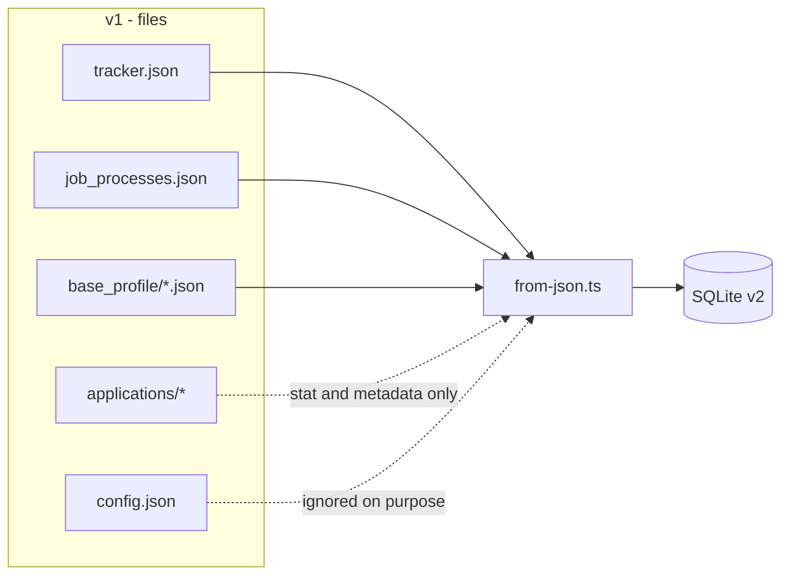

# v1 → v2 migration

## 1. Strategy

v1 kept everything in JSON files under its own project directory (called `<legacy-dir>` below):

| File | Content |
|---|---|
| `job_tracker.json` (or similar) | Jobs/applications |
| `job_processes.json` | Processing checkpoints |
| `base_profile/*.json` | Extracted base resumes |
| `config.json` | Configuration, including the LLM key |
| `applications/<slug>/*` | Generated PDFs, HTMLs, texts and JSONs |

v2 does not read these files at runtime. The migration is a **one-off importer**
(`src/migrations/from-json.ts`) that runs before the application comes up and writes everything to
SQLite. v1 stays intact as a fallback.



## 2. How to run

```bash
# 1. Make sure the database is on the latest schema
pnpm db:migrate

# 2. Import (the database must be empty)
pnpm db:import -- --tracker <legacy-dir>

# Or wipe and re-import
pnpm db:import -- --reset
```

Options accepted by the script (via `parseArgs`):

| Flag | Default | Description |
|---|---|---|
| `--tracker` | `<legacy-dir>` | v1 directory |
| `--db` | `data/job-search.db` | Target database |
| `--reset` | `false` | Wipe jobs/runs/artifacts before importing |

The importer opens a single transaction: either everything goes in, or nothing does. At the end it
prints a report with counts and warnings.

## 3. Result of the real import

```text
Importação concluída:
  vagas:     16
  processos: 34 (17 sem vaga)
  artefatos: 97
  perfis:    4
  settings:  2
```

### Expected warnings

- `config.json não importado de propósito: contém chave de API da LLM.`
- `17 processo(s) sem vaga correspondente (jobId nulo).`

The orphan runs are not an error: they are old checkpoints whose job was deleted in v1. They stay
valid and appear in `/api/runs`; the v1 UI doesn't show them because it filters `stage != done`.

## 4. Field mapping

### Job → `jobs`

| v1 | v2 | Transformation |
|---|---|---|
| `id` | `id` | Kept when it already has a prefix; otherwise a `app_<uuid>` is generated |
| `date` | `appliedAt` | `dd/mm/yyyy` → ISO 8601 UTC |
| `company` | `company` | Trim |
| `role` | `role` | Trim |
| `language` | `language` | `en` or `pt-br` |
| `languageConfirmation` | `languageConfirmation` | Preserved (`user-confirmed`) |
| `stack` | `stack` | Lowercase; default `ruby` |
| `channel` | `channel` | Direct |
| `status` | `status` | Normalized into the new enum (see below) |
| `fitRating`, `fitAnalysis`, `strengths`, `gaps` | `fit` | Grouped into the `Fit` object |
| `fitDimensions` | `fit.dimensions` | Direct |
| `eligibility`, `languageGate`, `logisticsNote` | `fit.*` | Direct |
| `vacancyUrl`, `applyUrl` | `vacancyUrl`, `applyUrl` | Direct |
| `appliedEmails` | `appliedEmails` | JSON array |
| `coverInCvRequired`, `coverInCvReason`, `coverLetterGuidance` | same | Direct |
| `hasRecruiterMessage`, `hasQuestions`, `skillGrounded`, `fitConfirmed` | same | Booleans |

### Status normalization

| v1 | v2 |
|---|---|
| `rascunho`, `drafted` | `drafted` |
| `aplicado`, `applied` | `applied` |
| `entrevista`, `interview` | `interview` |
| `proposta`, `offer` | `offer` |
| `encerrado`, `closed`, `desistido`, `rejected` | `rejected` |
| `arquivado`, `archived` | `archived` |

An unknown status produces a warning and falls back to `drafted`. The same table is used at
runtime by the compatibility DTO.

### Process → `runs`

| v1 | v2 |
|---|---|
| `id` | `id` (`proc_`) |
| `applicationId` | `jobId` (null if the job doesn't exist) |
| `stage` | `stage` |
| `url` | `url` |
| `stack` | `stack` |
| `languagePreference`, `detectedLanguage`, `suggestedLanguage` | same |
| `needsLanguageConfirmation`, `needsFitConfirmation`, `eligibilityBlocked` | same |
| `hasRawText`, `hasExtraQuestions`, `hasRecruiterMessage` | same |
| `error` | `error` |
| `fit` | `fit` (flattened → object) |
| `job` | `job` (metadata) |
| `jobSnapshot` | `jobSnapshot` (includes `content`, `extraQuestions`, `recruiterMessage`) |
| `createdAt` | `createdAt` (normalized to ISO) |

### Artifacts

v1 referenced files by path inside `applications/`. The importer:

1. extracts the relative path from each reference;
2. checks whether the file exists on disk (`fs.stat`);
3. writes `kind`, `relativePath`, `mime`, `sizeBytes` and `createdAt`.

**The content is never copied into the database.** If the file doesn't exist, is the artifact still
imported? No — broken references are logged as a warning and omitted, so the database doesn't
promise nonexistent files.

The unique index `(job_id, kind, relative_path)` guarantees that re-importing doesn't duplicate.

### Profiles and settings

- `base_profile/*.json` → `profiles`, with `content` keeping the original JSON.
- `pdf_theme` and `candidate_form` → `settings`.

## 5. What was deliberately not imported

| Item | Reason |
|---|---|
| `config.json` / LLM key | Secret. Reconfigure in v2 via environment variable |
| Artifact content | Stays on the filesystem; the database only keeps metadata |
| Caches and temporary files | No historical value |
| v1 logs | Not part of the domain |

## 6. Post-import validation

The smoke test used during the real migration:

```bash
pnpm dev &   # comes up on 3344
curl -s localhost:3344/api/stats
curl -s localhost:3344/api/applications | head -c 500
curl -s localhost:3344/api/processes
curl -s localhost:3344/cv/<id> | head
```

Expected result (with real data):

```text
stats  {"total":16,"byStatus":{"applied":13,"drafted":2,"rejected":1},"averageFitRating":69.9}
applications 16 items, date 28/10/2026, fit 77.5
pending processes 1
/cv/:id 200 text/html
static PDF 200 application/pdf
```

## 7. Rollback

v1 is never modified. To go back:

```bash
# stop v2
rm data/job-search.db       # or keep a copy beforehand
cd <legacy-dir> && pnpm start
```

v1 keeps reading the same JSONs and serving the same artifacts.

## 8. Re-import

The importer refuses to run against a populated database unless `--reset` is passed. This avoids
accidentally duplicating data. `--reset` wipes jobs, runs and artifacts, but does **not** wipe
profiles, settings or the files in `applications/`.

If the schema changed between imports, run `pnpm db:migrate` first.
